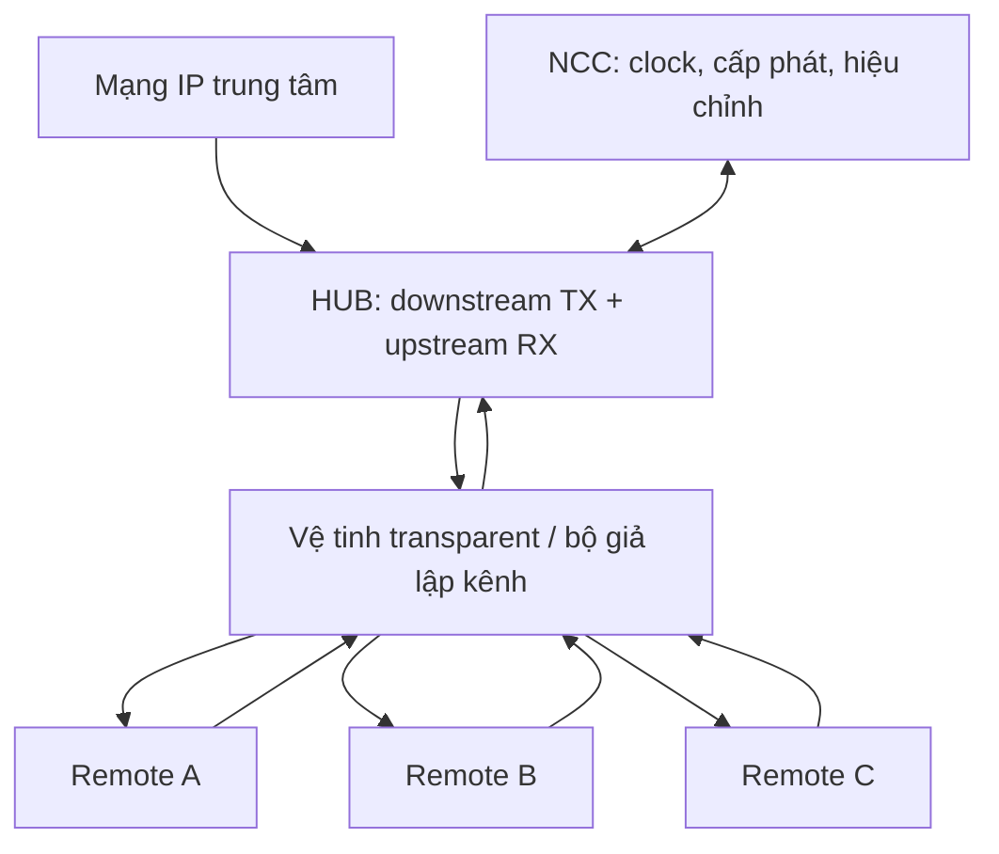

# 02. Kiến trúc hệ thống, giao thức và hợp đồng giao tiếp

> **Cập nhật CR-002 — 31/10/2026:** HUB downstream IP cực đại hỗ trợ **≥10 Mbit/s**; VSAT upstream IP cực đại **3 Mbit/s** khi được cấp đủ tài nguyên. Phương án sizing: downstream QPSK 12,5 Msym/s, rate 1/2; upstream QPSK tới 5 Msym/s, một Turbo profile mục tiêu rate 1/2. Đề xuất nâng HUB upstream lên **≥6 Mbit/s tổng/2 carrier**; đây là chỉ tiêu suy ra để phê duyệt, không phải yêu cầu người dùng đã chốt. Các rate thấp chỉ phục vụ bring-up. Xem [baseline tốc độ](../01_Yeu_cau/CR002_Baseline_10M_3M.md); ví dụ số ở rate thấp vẫn là ví dụ, không là trần tốc độ sản phẩm. Tại upstream 5 Msym/s, mục tiêu timing 0,25 symbol tương ứng **50 ns**, phải kiểm chứng lại.

## 1. Mục đích và nguyên tắc

Mục đích là chia một hệ thống lớn thành các khối có chủ sở hữu, đầu vào/đầu ra và phép thử độc lập. Yêu cầu: mọi khối thống nhất đơn vị thời gian, symbol, bit order, endian, rate, clock/reset và hành vi khi thiếu dữ liệu. Phương án dưới đây là đề xuất kiến trúc cho profile nghiên cứu; chỉ các khối DVB-S2 đã kiểm chứng mới được gắn nhãn chuẩn [S1].

## 2. Cấu trúc toàn mạng

HUB và NCC có thể cùng máy chủ ở prototype nhưng phải tách chức năng logic. HUB PHY mang timestamp và số đo burst; NCC nhận số đo để cập nhật trạng thái từng remote. Hệ thống điều khiển không đo thời điểm qua thời gian một gói Ethernet đến ứng dụng.

| Thành phần | Nhiệm vụ | Đầu ra có thể kiểm chứng |
|---|---|---|
| Downstream feeder | Phát đồng hồ tham chiếu, signalling, IP | DVB-S2 đúng profile, có frame counter và mốc tham chiếu |
| HUB burst RX | Thu nhiều carrier, xác định burst/terminal | Payload, CRC, timestamp arrival, CFO, mức tín hiệu, quality |
| NCC | Admission, ranging, grant, frequency/power/timing loops | Grant không xung đột, corrections có epoch hiệu lực |
| Remote | Downstream RX, MAC, upstream TX | Burst đúng khe/tần số/rate/power, tự mute khi mất điều kiện |
| NMS | Provisioning, quan sát, update, fault | Inventory, alarms, export log, cấu hình version hóa |
| Kênh thử | Delay, attenuation, CFO, drift, nhiễu | Điều kiện thử lặp lại được cho từng chiều |

Một modem HUB chỉ có một bộ thu tune lần lượt không đủ thu hai carrier có burst chồng thời gian. HUB phải dùng wideband capture + channelizer/bank DDC, hoặc nhiều receiver đồng thời. Đây là yêu cầu xác nhận MF-TDMA thực sự.

## 3. Phân chia phần xử lý của remote

| Miền | Chức năng đặt tại đây | Căn cứ lựa chọn |
|---|---|---|
| PS Linux | IP stack, management, provisioning, MAC policy, driver, thống kê | Cần linh hoạt và quản lý tài nguyên |
| Zynq PL | AD9361 interface, local time, timed TX, FIFO, timestamp, phần PHY phù hợp | Cần độ trễ và deadline xác định |
| FPGA phụ | LDPC decoder và/hoặc các khối PHY nặng được chốt sau PoC | Tăng tài nguyên khi có số đo chứng minh |
| AD9361 | RF conversion, filtering/rate chain, gain và calibration nội | Tầng RF, không thay xử lý modem |
| RF/IFL | Match/filter/attenuate, nguồn BUC/LNB, reference, protection | Điện áp/công suất RF ngoài chip |

Không đưa quyết định phát từng burst vào userspace timer. PS có thể nạp descriptor sớm; PL kiểm tra quyền phát và thực thi theo counter. Nếu đặt RX synchronizer ở Zynq và LDPC ở FPGA phụ, interface nên truyền LLR + metadata thay vì toàn bộ I/Q. Nếu đặt toàn bộ RX ở FPGA phụ thì băng thông I/Q và timestamp crossing tăng; phải so sánh hai lựa chọn bằng số.

## 4. Phân chia HUB prototype và HUB mở rộng

**Mục đích:** tránh buộc HUB mẫu vào cùng tài nguyên nhỏ với remote. **Yêu cầu:** ít nhất hai upstream carrier đồng thời, clock chung giữa timestamp RX và timeline NCC, downstream reference có mốc cố định.

**Phương án:** HUB ban đầu dùng PC/server chạy NCC và có thể chạy một phần FEC, SDR capture liên tục, FPGA thực hiện timestamp/channelization/burst detect. Chỉ gọi đó là HUB thử nghiệm; thông lượng và latency phải đo thực tế. Khi cần HUB độc lập, chuyển các đoạn nóng về FPGA lớn hơn hoặc nhiều board, còn NCC giữ API. Không cam kết HUB nhiều carrier chạy tất cả trên một Zynq-7020.

**Nội dung chi tiết:** xây API `rx_burst_report`, `schedule_commit`, `reference_event`, `terminal_state`; đo worst-case execution time của xử lý burst; cấp buffer đủ các burst liên tiếp; lưu trace đến từng grant. **Lộ trình:** HUB software-in-loop tháng 2–4, hai carrier IF tháng 10–12, kiểm tra tải tháng 16–20.

## 5. Luồng dữ liệu và luồng điều khiển

### 5.1 Downstream

IP → classifier/queue → encapsulation → BBFRAME → BCH → LDPC → mapping/PL framing → pulse shaping → AD9361 TX tại HUB. Tại remote thực hiện chuỗi ngược, gồm acquisition/tracking và giải mã trước khi giao IP về Linux. Encapsulation chọn một trong hai hướng:

- TS làm vật mang thử ban đầu: dễ đối chiếu một số project SDR, nhưng phải quy định rõ cách chở IP/signalling và overhead; không coi private payload là chuẩn network interoperability.
- GSE cho hướng IP lâu dài [S21]: cần implementation và test fragmentation/reassembly, MTU, label và CRC đúng đặc tả được chọn. Đưa vào baseline nếu có thư viện phù hợp và người phụ trách; nếu chưa có, giữ nó là công việc mở rộng có gate.

Không nhúng timestamp tham chiếu bằng thời điểm userspace ghi payload: nội dung payload có thể nằm chờ trong hàng đợi. Phải liên kết timestamp với một sự kiện PHY cụ thể và cấu hình pipeline đã biết (file 05).

### 5.2 Upstream

Ethernet → QoS queue → bandwidth request → grant từ NCC → fragment/pack payload → FEC → burst builder → timed waveform FIFO → NCO/DUC → AD9361 TX. HUB channelizes → detects/estimates → demaps/FEC/CRC → reassembles → IP gateway; đồng thời gửi số đo về NCC.

### 5.3 Kênh điều khiển

Phải có tài nguyên được bảo đảm cho reference, discovery, grants và corrections ngay cả khi user traffic đầy tải. Các message proposal: `NETWORK_ANNOUNCE`, `TIME_REF`, `LOGON_REQ`, `RANGING_GRANT`, `RANGING_REPORT`, `CORRECTION`, `RESOURCE_REQUEST`, `BURST_GRANT`, `KEEPALIVE`, `TX_INHIBIT`. Các tên này là của profile riêng, không phải tên bản tin ETSI. Khi chuyển RCS2, thay bằng signalling/bảng tiêu chuẩn phù hợp [S2], không chỉ đổi tên.

Mỗi message cần: protocol version, network ID, source/destination, sequence, epoch/effective frame, payload length, integrity/authentication theo lớp, reason/error code. Dùng parser có giới hạn độ dài; không dùng con trỏ trực tiếp vào dữ liệu chưa kiểm tra.

## 6. Hợp đồng timed TX đề xuất

Descriptor tối thiểu:

| Trường | Ý nghĩa | Kiểm tra |
|---|---|---|
| `schedule_epoch`, `grant_id`, `terminal_id` | Chống nhầm lịch và phát lặp | Khớp epoch đang hoạt động; grant chưa dùng |
| `tx_time_integer`, `tx_time_fraction` | Mốc bắt đầu tại điểm chuẩn đã định nghĩa | Không quá hạn; trong cửa sổ grant |
| `carrier_offset_hz`, `symbol_rate_id` | Đặt NCO và rate chain | Nằm trong whitelist cấu hình |
| `waveform_id`, `payload_len`, `buffer_id` | Chọn FEC/burst profile và payload | Không vượt codeblock/buffer |
| `power_profile_id`, `ramp_id` | Cấu hình envelope | Không vượt trần power/IFL |
| `duration_samples`, `flags`, `CRC` | Giới hạn phát, mode, chống lỗi descriptor | Length hợp lệ; flags dự phòng bằng 0 |

Trình tự: PS chuẩn bị → PL kiểm tra → ACK accepted/rejected → arm → launch → completion có timestamp. Không sửa descriptor đang arm. Cập nhật lịch dùng double buffer, commit ở epoch định trước; reset giữa chừng phải hủy toàn bộ lịch cũ. Không được “phát muộn cho đủ dữ liệu”.

## 7. Giao tiếp RX và đo lường

Metadata `rx_burst_report`: physical carrier ID; expected grant ID nếu biết; detected preamble time tại điểm tham chiếu; timing fractional; CFO Hz; phase estimate; RSSI/EsN0 có calibration; payload bytes; CRC/FEC status; decoder iteration; overflow flag; quality của timestamp. Logon chưa biết terminal ID thì chưa được dùng kết quả mù để sửa một remote bất kỳ.

Với DVB-S2 RX, xuất thêm PL lock, PLS decode, MODCOD, pilot flag, FECFRAME count, BCH failures và BBFRAME CRC. Không dùng một đèn “RX lock” cho mọi lớp: clock lock, PL lock, FEC lock và network operational là các trạng thái khác nhau.

## 8. Hợp đồng clock/reset/backpressure

Mỗi interface ghi rõ clock source, reset polarity, reset release synchronization, data valid/ready và quy tắc tạm dừng. RF samples không thể bị dừng tùy tiện vì downstream AXI `ready=0`; cần FIFO và chính sách overflow. Payload và LLR có thể backpressure trước khi deadline, còn timed waveform đã launch cần tốc độ không gián đoạn.

Timestamp đi cùng data qua CDC bằng record/FIFO, không đồng bộ từng bit của counter đa bit độc lập. CDC của event phải bảo đảm không mất xung; cấu hình multi-bit dùng handshake hoặc shadow register + commit.

## 9. Danh mục tài liệu giao tiếp bắt buộc

ICD-01 RF/IFL; ICD-02 clock/time; ICD-03 PS–PL register và DMA ABI; ICD-04 liên FPGA; ICD-05 waveform/bit mapping/FEC; ICD-06 message/network; ICD-07 telemetry/test. Mỗi ICD có version, owner và golden transaction. Mọi thay đổi ảnh hưởng hai nhóm phải cập nhật model và regression trước khi merge. Mốc hoàn thành bản đầu tháng 2, đóng băng baseline tháng 4; sau đó thay đổi có impact assessment.
