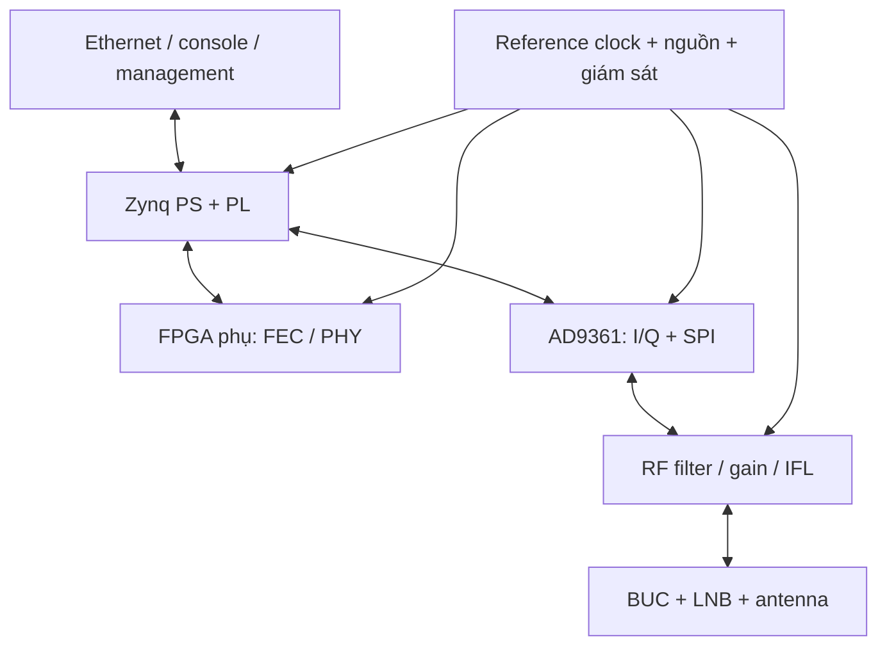

# 03. Phương án phần cứng, RF, clock và liên FPGA

> **Cập nhật CR-002 — 31/10/2026:** HUB downstream IP cực đại hỗ trợ **≥10 Mbit/s**; VSAT upstream IP cực đại **3 Mbit/s** khi được cấp đủ tài nguyên. Phương án sizing: downstream QPSK 12,5 Msym/s, rate 1/2; upstream QPSK tới 5 Msym/s, một Turbo profile mục tiêu rate 1/2. Đề xuất nâng HUB upstream lên **≥6 Mbit/s tổng/2 carrier**; đây là chỉ tiêu suy ra để phê duyệt, không phải yêu cầu người dùng đã chốt. Các rate thấp chỉ phục vụ bring-up. Xem [baseline tốc độ](../01_Yeu_cau/CR002_Baseline_10M_3M.md); ví dụ số ở rate thấp vẫn là ví dụ, không là trần tốc độ sản phẩm. Tại upstream 5 Msym/s, mục tiêu timing 0,25 symbol tương ứng **50 ns**, phải kiểm chứng lại.

## 1. Cơ sở lựa chọn

AD9361 là RF transceiver 2T2R, ADC/DAC 12 bit, hỗ trợ FDD/TDD, RX 70 MHz–6 GHz và TX 47 MHz–6 GHz theo datasheet Rev.G, băng thông kênh tới 56 MHz [S5]. Thiết kế tham chiếu ADI cung cấp HDL interface và DMA [S7–S10], không cung cấp sẵn toàn bộ modem DVB-S2/MF-TDMA. RF/IFL đề xuất dưới đây cần thiết kế và đo riêng.

## 2. Khối phần cứng remote

Vị trí nối AD9361 với Zynq PL được chọn để tái sử dụng đường ADI sớm. Đưa AD9361 trực tiếp sang FPGA phụ chỉ khi chứng minh giảm tải tốt hơn; việc đó đổi clocking, calibration và phần mềm hỗ trợ. Chưa khóa schematic theo sơ đồ chức năng này.

## 3. So sánh Zynq-7020 và 7030

Các tài nguyên danh định theo AMD DS190 [S11]; không phải kết quả thiết kế của đề tài.

| Tài nguyên | XC7Z020 | XC7Z030 | Hệ quả |
|---|---:|---:|---|
| LUT | 53.200 | 78.600 | 7030 có thêm chỗ cho interface, debug và PHY |
| DSP48 | 220 | 400 | Có ích cho filter/DDC, không thay băng thông decoder |
| BRAM 36 Kb | 140 | 265 | 7030 thuận lợi hơn cho FIFO, soft bits và FEC |
| Serial transceiver tích hợp | Không có GTX/GTP | Có GTX, phụ thuộc package | 7020 không dùng Aurora qua GTX trực tiếp |

**Phương án ưu tiên:** 7030 + FPGA phụ khi cần serial link ít chân và có nguồn lực SI/clock; 7020 + FPGA phụ khi ưu tiên chi phí và chấp nhận bus SelectIO source-synchronous. Không thể chọn 7020 rồi lập kế hoạch dùng transceiver cứng giống 7030. Phải kiểm pin/package/bank của đúng mã hàng trước đặt PCB. Không giả định package 676 tồn tại hoặc tương thích cho mọi chip trong họ.

FPGA phụ có thể xét Artix-7 XC7A200T hoặc thiết bị tương đương; chưa khẳng định đủ tài nguyên. PoC phải đo LUT, BRAM, clock, routing và decoder throughput trước chốt. Quyền license công cụ/soft IP và khả năng hỗ trợ target cũng nằm trong quyết định.

## 4. Tính băng thông số trước khi phân chia khối

### 4.1 I/Q

Với N luồng RF phức, tốc độ mẫu fs, mỗi thành phần I hoặc Q có b bit:

`R_IQ = fs × N × 2 × b` bit/s, chưa overhead.

Ví dụ 1R1T, fs = 30,72 MS/s, I/Q đóng gói mỗi thành phần 16 bit: một chiều 983,04 Mbit/s = 122,88 MB/s. Hai chiều đồng thời: 245,76 MB/s payload tổng. Nếu giữ đúng 12 bit thì một chiều 737,28 Mbit/s, nhưng cần chứng minh packing/unpacking. 2R2T tăng gấp đôi. Băng thông DDR/AXI thực phải cộng traffic khác, burst inefficiency và DMA overhead.

Không chuyển mọi I/Q vào DDR rồi đưa ngược ra chỉ vì thiết kế tham chiếu làm như vậy. Với đường thời gian thực, ưu tiên stream trong PL; DDR dùng packet, lưu trace hoặc buffer có kiểm soát. PS Ethernet không phải đường vận chuyển raw I/Q mục tiêu.

### 4.2 LLR

`R_LLR = Rs × log2(M) × q`, q là số bit soft decision. QPSK 10 Msym/s, q=6: 120 Mbit/s; 16APSK cùng rate: 240 Mbit/s, chưa metadata, pilot và framing hiệu dụng. Đây là ví dụ sizing upper envelope theo symbols payload, không phải bit rate IP. Chuyển LLR thường nhẹ hơn I/Q nhưng không phải miễn phí; phải giữ thứ tự FECFRAME, MODCOD và backpressure.

### 4.3 Bộ nhớ FEC

Một FECFRAME normal 64.800 bit, lưu 6 bit LLR cho mỗi coded bit cần 388.800 bit ≈48,6 kB cho riêng channel LLR. Decoder còn cần messages, extrinsic state, addressing, double buffers; do đó không lấy 48,6 kB làm toàn bộ RAM LDPC. Các con số frame length lấy theo [S1]; ước lượng bộ nhớ là phép tính của phương án.

## 5. AD9361 có đáp ứng symbol rate không?

Với pulse shaping raised-cosine, băng thông RF danh định xấp xỉ `B ≈ Rs(1+α)`. Ví dụ Rs=10 Msym/s, α=0,25 → 12,5 MHz; Rs=45 Msym/s, α=0,20 → 54 MHz. Trường hợp 45 Msym/s đã sát trần channel bandwidth 56 MHz; chưa tính guard cho filter thực và analog response. Không được kết luận khả thi chỉ vì 54 < 56.

Luồng số ADI tham chiếu nêu mức tới 61,44 MS/s theo mode [S10]. Nếu receiver dùng 2 samples/symbol thì 45 Msym/s đòi 90 MS/s, vượt mức này ở interface; muốn làm phải dùng kiến trúc resampling khác hoặc đổi front-end, rồi kiểm chứng. Vì vậy không đặt trần X5 45 Msym/s thành baseline của AD9361 prototype. Phải kiểm cả bandwidth analog, sample clock chain, LVDS timing, DSP processing rate và decoder đồng thời.

FDD cần RX downstream và TX upstream khác tần số nhưng chia sẻ các ràng buộc clock/rate chain của chip. Chốt một sample clock cố định phù hợp cả hai chiều và dùng DDC/DUC/resampling trong PL cho rate nhỏ hơn; không giả định TX/RX sample rate độc lập tùy ý. Không reset/recalibrate RF mỗi khe.

## 6. MF-TDMA đổi tần như thế nào?

**Mục đích:** remote chuyển giữa carrier được cấp mà không làm trễ burst. **Yêu cầu:** carrier đúng tần, ổn định trước preamble; không phá downstream RX đang liên tục.

**Phương án cơ sở:** đặt LO TX cố định che phủ toàn bộ nhóm upstream carrier trong một băng số vừa AD9361; đổi offset bằng NCO/DUC trong PL theo descriptor. HUB thu toàn băng này bằng một RX wideband và bank DDC/channelizer. Tính điều kiện `span_carriers + filter margins ≤ usable_RF_bandwidth`, tránh DC/LO spur và ảnh alias. Chọn complex NCO, rate conversion và filter có state management đúng ranh giới burst.

**Phương án thay thế:** retune LO/fastlock khi carriers cách xa vượt băng tức thời. Phải đo settling time trên tần số/nhiệt/điện áp, gồm gain/calibration và BUC transient; dành khe chuyển tần rõ ràng. Không dùng một số fastlock điển hình làm deadline worst case. Chi tiết điều khiển đọc UG-570 [S6], sau đó xác minh bench.

**Lộ trình:** NCO một carrier tháng 4–6; hai carrier tháng 8–12; chỉ đánh giá retune sau khi baseline hoạt động. Kiểm tra đổi carrier trên cùng một remote, không chỉ hai remote cố định ở hai tần số.

## 7. Giao tiếp liên FPGA

| Hướng | Ưu điểm | Rủi ro/công việc bắt buộc | Khuyến nghị |
|---|---|---|---|
| SelectIO LVDS source-synchronous | Dùng được với 7020; không cần hard transceiver | Nhiều pin/pair, timing/skew, training, board SI | Phương án 7020 |
| GTX Zynq ↔ GTP Artix, serial protocol/Aurora nếu IP hỗ trợ hai đầu | Ít chân; full-duplex; framing/flow control thuận tiện | Clock ref, line rate chung, IP/config compatibility, reset/link recovery | Ưu tiên 7030 sau PoC |
| LVCMOS song song | Dễ hiểu ở rate thấp | EMI, pin, skew; không coi 32 bit là đủ tốc độ | Chỉ control/PoC ngắn nếu đo đạt |

Hai hướng dữ liệu đồng thời cần hai đường logic độc lập hoặc protocol duplex rõ ràng. Với serial một lane full-duplex có cặp TX và cặp RX riêng; không chỉ một cặp dây cho cả hai chiều. Với bus chia thời gian phải tính turnaround và mất băng thông.

Ví dụ bus 16 bit SDR ×100 MHz: 1,6 Gbit/s thô mỗi hướng; hiệu suất 70% giả định →1,12 Gbit/s. Bus 32 bit SDR ×100 MHz: 3,2 Gbit/s thô, 2,24 Gbit/s với cùng giả định. Không dùng 70% như số đo; đo payload efficiency và worst-case stall thực tế.

Ví dụ serial line 3,125 Gbit/s, nếu 8b/10b thì trần trước framing là 2,5 Gbit/s. Thêm CRC/headers/flow control giảm tiếp; phải xác nhận cả hai target/package/IP đạt line rate chung. Không lấy nominal GTX maximum làm throughput hệ thống.

Protocol tối thiểu có type, length, stream/frame ID, sequence, config version, CRC, credit, link epoch và error counters. Time-domain owner duy nhất là Zynq PL hoặc master clock đã quy định. Không cho FPGA phụ tự quyết thời điểm TX dựa trên lúc nhận packet serial có latency thay đổi; trả payload sớm và timed TX ở phía sát RF.

## 8. Clock và reference

**Mục đích:** giảm drift đủ cho timing/frequency tracking. **Yêu cầu:** reference phase noise tốt, có khả năng đo tần số, holdover và báo mất reference.

Đề xuất HUB có reference ổn định, remote dùng TCXO/OCXO phù hợp ngân sách sai số; tùy cấu hình nhận 10 MHz/PPS ngoài phục vụ đo và GNSS. Clock AD9361 được tạo theo yêu cầu UG-570, không mặc định nối thẳng 10 MHz khi chưa xác nhận cấu hình. Module IFL có reference 10 MHz cho BUC/LNB khi cần, với lọc và cách ly.

PL network time dùng counter + frequency accumulator để bám reference nhận từ mạng; clock vật lý không nhất thiết chính xác 27 MHz. Nếu tuyên bố RCS2, phải thể hiện đơn vị NCR/signalling đúng chuẩn. Timestamp resolution, oscillator accuracy và RF launch accuracy là ba đại lượng khác nhau. Xem ngân sách ở file 05.

## 9. RF/IFL, cấp nguồn và bảo vệ

AD9361 nối miền L-band qua balun/matching, filter RX/TX, gain/attenuator theo level budget. Type-F/75 Ω của hệ VSAT không mặc nhiên khớp RF 50 Ω; cần thiết kế chuyển tiếp và đo return loss. Phải xác định input composite tối đa, overload với nhiều carrier và mức blocker ngoài băng; khả năng thu yếu không đủ nếu mạnh lân cận làm ADC clip.

Module IFL phải xử lý DC feed BUC/LNB, bias tee, 10 MHz injection, tone/control nếu yêu cầu; dùng eFuse/current limit, surge/ESD, reverse protection, fault telemetry và hardware inhibit. Không để điện áp DC ngoài lọt về port AD9361. Tính sụt áp cáp, dòng khởi động và nhiệt; chỉ tiêu nguồn căn cứ BUC/LNB thực chọn, không sao chép mặc định X5.

Đo TX leakage vào RX khi FDD: cách ly connector, shield, filter, layout và nguồn. Chứng minh sensitivity trong lúc TX mức lớn, không chỉ đo RX khi tắt TX. BUC có thể tạo transient và spectral regrowth; lập ngân sách back-off cho QPSK/8PSK/16APSK riêng, đo envelope và ACPR ở cả IF và sau BUC nếu có thiết bị phù hợp.

## 10. PCB, bộ nhớ và sản xuất

Mỗi board cần DDR3/DDR3L, QSPI/eMMC hoặc SD cho boot, Ethernet PHY, JTAG hai chip, console, EEPROM board ID, temperature/power sensing và đầu test reference. DDR capacity chọn theo queue/trace/OS; không lấy capacity thay cho bandwidth. Giữ đường recovery boot và khả năng nạp lại FPGA phụ khi link chưa hoạt động.

SI/PI: kiểm LVDS bank voltage, termination, length/skew, reference-plane continuity, decoupling, rail sequencing, reset supervisor và thermal. DFT: loopback serial, PRBS, testpoint clock, current measurement, RF coupler/port test. BOM có nguồn thứ hai cho nguồn/clock/passive khi khả thi; đánh giá vòng đời FPGA/AD9361 tại thời điểm mua, chưa có báo giá/stock được xác minh trong hồ sơ này.

Lộ trình phần cứng: dev board tháng 1–8; schematic/prototype PCB vòng 1 tháng 7–12 sau architecture gate; vòng 2 tháng 15–18; giữ tháng 19–24 cho bring-up, EMI/thermal sửa nhỏ và kiểm chứng. Không sản xuất PCB tích hợp đầu tiên trước khi PoC FEC/link/clock đạt.
