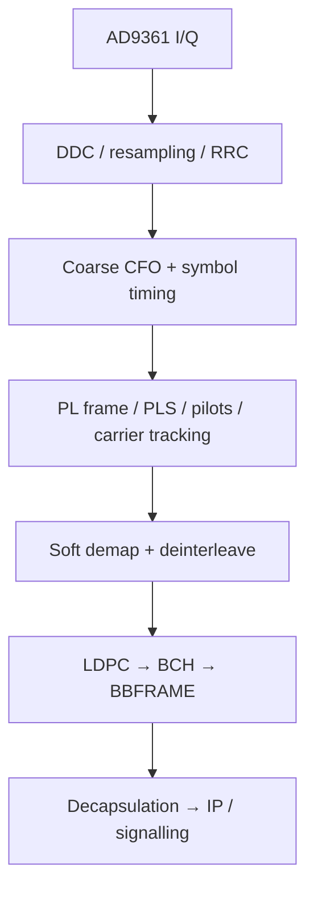

# 04. Phương án PHY, FEC và xử lý tín hiệu

> **Cập nhật CR-002 — 31/10/2026:** HUB downstream IP cực đại hỗ trợ **≥10 Mbit/s**; VSAT upstream IP cực đại **3 Mbit/s** khi được cấp đủ tài nguyên. Phương án sizing: downstream QPSK 12,5 Msym/s, rate 1/2; upstream QPSK tới 5 Msym/s, một Turbo profile mục tiêu rate 1/2. Đề xuất nâng HUB upstream lên **≥6 Mbit/s tổng/2 carrier**; đây là chỉ tiêu suy ra để phê duyệt, không phải yêu cầu người dùng đã chốt. Các rate thấp chỉ phục vụ bring-up. Xem [baseline tốc độ](../01_Yeu_cau/CR002_Baseline_10M_3M.md); ví dụ số ở rate thấp vẫn là ví dụ, không là trần tốc độ sản phẩm. Tại upstream 5 Msym/s, mục tiêu timing 0,25 symbol tương ứng **50 ns**, phải kiểm chứng lại.

Các lựa chọn thuật toán và lịch triển khai trong file này là đề xuất thiết kế; không phải toàn bộ đều do tiêu chuẩn quy định. DVB-S2 waveform phải đối chiếu [S1]; profile burst/Turbo tham khảo [S2]. Các project [S12–S14] dùng làm đối chứng, không phải HDL sẵn sàng cho target.

## 1. Tổ chức công việc DSP theo ba mô hình

**Mục đích:** chứng minh tính đúng trước khi tối ưu tài nguyên. **Yêu cầu:** cùng input phải truy được output tại các ranh giới FECFRAME/burst, kể cả khi có saturation và packet loss.

**Phương án:** mô hình floating-point làm chuẩn thuật toán; mô hình fixed-point bit-accurate mô tả đúng lượng tử; RTL tương đương fixed-point và đạt timing. Mỗi vector lưu seed, sample rate, scaling, endian, MODCOD, frame ID và impairment. Không chỉ so waveform nhìn giống trên FFT.

**Nội dung:** tạo vector sạch → AWGN → CFO/phase → sample offset/drift → phase noise/IQ/DC → nonlinear PA → nhiều burst/near-far. Đánh giá từng impairment và phối hợp. **Lộ trình:** model đầu tháng 2, fixed-point tháng 4–8, RTL từng lát cắt tháng 5–14, regression liên tục.

## 2. DVB-S2 TX tại HUB

Mục đích là tạo nguồn downstream chuẩn để kiểm remote và chở signalling. Yêu cầu hoàn thành một cấu hình nhỏ đúng chuẩn trước khi tăng tốc: cấu trúc BBFRAME, scrambling, BCH/LDPC, mapping, PLHEADER/pilots và shaping đúng profile [S1].

Phương án ban đầu dùng transmitter SDR tham chiếu để có nguồn độc lập; triển khai HUB TX FPGA sau hoặc song song nếu nhiệm vụ yêu cầu làm chủ. Với CCM, nguồn phát một MODCOD cố định. Khi không có dữ liệu vẫn duy trì waveform/clock theo cơ chế chuẩn thích hợp, không dừng RF ngẫu nhiên làm remote mất lock.

Nội dung thực hiện: vector bit tại từng boundary; kiểm BBHEADER/CRC, padding và bit ordering; kiểm parity; kiểm constellation normalization và pilot position; kiểm RRC impulse response và power normalization; xuất test vector I/Q để đo độc lập. Lộ trình tháng 2–5 cho nguồn đối chứng, tháng 6–10 cho TX tích hợp nếu nằm trong baseline.

## 3. DVB-S2 RX tại remote

### 3.1 Chuỗi xử lý đề xuất

Thứ tự và vòng lặp acquisition có thể cần tương tác, không xem sơ đồ như duy nhất một pipeline tuyến tính. Thuật toán được chọn sau khi mô phỏng miền bắt và SNR yêu cầu.

### 3.2 Từng khối cần làm chủ

| Khối | Mục đích/yêu cầu | Phương án và phép thử |
|---|---|---|
| Level/DC/IQ | Tránh clipping và bias LLR | Dựa gain AD9361 + scaling PL; đo DC/LO spur, không lọc DC quá mức làm méo carrier |
| RRC/matched filter | Tối ưu SNR và ISI | FIR/polyphase; kiểm response, group delay và overflow |
| Coarse frequency | Kéo residual CFO vào miền tracking | Correlation/spectral/non-data-aided estimator phù hợp QPSK trước; quét CFO hai dấu |
| Symbol timing | Lấy đúng vị trí symbol, bám sample-rate offset | Gardner hoặc estimator phù hợp oversampling, interpolator/Farrow; test fractional delay và drift |
| Frame synchronization | Xác định PLFRAME, chống false lock | SOF/PLS correlation; đo acquisition probability và false alarm |
| PLS decoding | Nhận mode/frame/pilot | Kiểm cấu hình unsupported, không giải mã nhầm rồi giao payload |
| Carrier phase | Khử residual CFO/phase, bám pilots | Pilot-aided + decision-directed khi phù hợp; test phase noise, cycle slip |
| Soft demapper | Sinh LLR đúng dấu/thang | Ước lượng noise variance; test noise scaling và clipping |
| Deinterleaver/FEC | Khôi phục payload | Vector độc lập, không nhầm bit permutation |
| BBFRAME/output | Lọc frame lỗi và chở dữ liệu | CRC/status, sequence; không giao IP khi FEC chưa tin cậy |

Không dùng cùng bộ loop bandwidth cho acquisition và tracking mà chưa kiểm. Acquisition nhanh thường đánh đổi noise; cần state machine chuyển chế độ có điều kiện, có timeout và đo reacquisition.

### 3.3 ACM

Mục đích là chọn MODCOD theo chất lượng từng remote trong downstream chung. Yêu cầu bộ thu xử lý thay đổi frame-by-frame trong tập mode hỗ trợ, HUB có feedback đủ tin cậy. Phương án: làm CCM trước; sau đó feedback quality có timestamp/age, filtering và hysteresis; scheduler chọn mode cho dữ liệu remote. Feedback GEO đến muộn nên không áp dụng điều khiển quá nhanh theo một mẫu SNR. Nghiệm thu bước giảm/tăng attenuation, không đo gain của ACM chỉ trên kênh tĩnh.

## 4. LDPC/BCH downstream — gói rủi ro cần tách riêng

**Mục đích:** giải mã liên tục ở tốc độ mục tiêu với hiệu năng RF chấp nhận được. **Yêu cầu:** đúng code/rate/frame length; worst-case iterations không làm tràn; correction/error status đáng tin.

**Phương án mua IP:** yêu cầu vendor xác nhận support DVB-S2 chính xác, target 7-series, throughput với số iteration, LUT/BRAM, Fmax sau routing, interface LLR, soft quantization, latency, testbench, perpetual/license và quyền bàn giao. Encoder IP không thay decoder IP. IP Turbo chung cho LTE không mặc nhiên đúng RCS2.

**Phương án tự làm:** nghiên cứu layered normalized/offset min-sum và memory banking; dựng decoder software bit-accurate; chọn q, saturation, early termination và max iteration; tổ chức pipeline/address ROM; regression parity syndrome và frame error. Các thuật toán decoder là lựa chọn implementation, tiêu chuẩn waveform không bắt buộc một kiến trúc decoder cụ thể.

**Sizing:** `frames/s = coded_payload_bit_rate / n_ldpc`; `T_decode_worst ≤ thời gian giữa các FECFRAME` nếu một engine, hoặc chứng minh buffer/multiple engine hấp thụ được. Ví dụ giả định coded stream 10 Mbit/s, n=64.800 → khoảng 154,3 frame/s, ngân sách trung bình 6,48 ms/frame. Đây là sizing chưa tính framing và không được coi là decoder throughput đã đo.

BCH decoder phải kiểm correction capability đúng cấu hình và báo uncorrectable; không bỏ BCH vì “LDPC đã sửa gần hết”. Test cả chuỗi encoder/decoder và vector độc lập. **Gate:** tháng 4 có kết quả synthesis PoC và BER/FER model; nếu thiếu, chốt mua IP hoặc giảm rate/profile ngay.

## 5. Upstream burst TX

**Mục đích:** tạo burst có thời điểm RF, tần số, công suất, độ dài chính xác. **Yêu cầu:** có preamble, payload, FEC, CRC, tail/ramp phù hợp profile, không phát ngoài grant.

**Phương án:** chọn một profile QPSK TC-LM tham khảo RCS2 nếu đi hướng Turbo. Tra chính xác waveform ID, codeblock, permutation/puncturing/mapping trong [S2], lập bảng config có version. Đề tài chưa tuyên bố một ID cụ thể đã được triển khai. Nếu chọn LDPC riêng upstream để tái sử dụng code, phải công bố đó là waveform riêng và đánh giá overhead/latency cho burst ngắn.

**Nội dung:** payload packing theo codeblock → CRC/scramble theo profile → Turbo encoder → symbol mapping → UW/preamble/pilots/postamble → RRC/interpolation → NCO → envelope → timed RF output. Tính delay filter và tail; đừng cắt RRC ở payload cuối. Chuẩn bị waveform đủ sớm, zero-pad/flush có kiểm soát. Theo dõi FIFO low watermark trước arm.

**Lộ trình:** burst không FEC phục vụ debug tháng 4–6; burst có FEC tháng 7–10; profile freeze tháng 10–12. Burst debug chưa đạt FEC không được tính là sản phẩm hoàn thành.

## 6. HUB burst RX — khó hơn continuous RX

Mỗi burst có thể từ remote khác nên phase, CFO, timing và power không liên tục. Không mang trạng thái PLL/AGC của burst A áp thẳng cho B. Trong từng carrier, receiver phải tái bắt đủ nhanh trong preamble; có thể dùng prior estimate theo terminal nhưng phải có giới hạn tuổi và fallback.

| Giai đoạn | Nội dung làm chủ | Phép thử trọng tâm |
|---|---|---|
| Channelization | DDC bank lúc ít carrier; PFB khi cần scale | Cách ly carrier, passband, group delay, adjacent blocker |
| Burst detection | Correlation UW hoặc energy + correlation | False alarm, missed burst, arrival ngoài dự đoán |
| Level/AGC | Wideband gain không phá burst các carrier khác | Burst mạnh/yếu đồng thời, clipping ADC |
| CFO/timing/phase | Data-aided estimator từ known symbols | Preamble ngắn, SNR thấp, CFO lớn |
| Tracking | Bám biến thiên trong burst | Drift, phase noise, residual timing |
| FEC/CRC | Decoder đủ backlog và codeblock throughput | Nhiều burst nối tiếp, max iterations |
| Metadata | Arrival timestamp ở reference nhất quán | Sai số fractional và latency phụ thuộc thuật toán |

Đề xuất giữ analog gain HUB tương đối ổn định khi thu nhiều carrier, dùng digital normalization từng carrier/burst. AGC analog chạy theo một burst mạnh có thể làm carrier khác mất tín hiệu. Với dynamic range không đủ, cần thêm phân băng/receiver, không giải quyết bằng phần mềm thuần túy.

## 7. Turbo upstream

Mục đích là FEC cho burst ngắn/rate đã chọn. Yêu cầu xác định đúng họ Turbo: product code và convolutional/double-binary Turbo không thay thế nhau. Brochure X5 không cung cấp đủ thông tin tái tạo toàn bộ inbound proprietary; không dùng nhãn “Turbo” làm đặc tả.

Đề xuất remote đặt encoder trong PL; HUB có thể decoder software ở tốc độ thấp để kiểm thuật toán, sau đó đưa vào FPGA/CPU tối ưu theo đo tải. Phải tính tail-biting/circulation, puncturing, interleaver, max-log-MAP scaling, iteration và memory. Mua core phải kiểm profile RCS2 thay vì chỉ xem tên Turbo.

Gate: tháng 6 có golden vector encoder/decoder đúng một waveform, tháng 10 có throughput worst case; không trì hoãn decoder HUB đến giai đoạn tích hợp cuối.

## 8. Fixed-point và chất lượng RF

Mỗi khối có bảng word length, binary point, rounding, saturation, peak range và quantization noise. Khởi đầu q LLR 5–8 bit là miền thử thiết kế, không phải đặc tả đã chốt. Sweep để chọn độ rộng bằng đường cong FER và tài nguyên. Lưu raw I/Q cùng LLR trước decoder để phân biệt lỗi RF/synchronizer/FEC.

Với PSK/APSK, test phase noise và nonlinear PA; CFO residual tốt chưa có nghĩa EVM/FER đạt. Ngân sách implementation loss là chênh ngưỡng Es/N0 tại cùng FER giữa DUT và model tham chiếu có cùng channel/profile, sau khi calibration. Không so Eb/N0 ở một biểu đồ với Es/N0 ở biểu đồ khác mà không quy đổi rate/overhead.

## 9. Kết quả phải bàn giao của nhóm PHY

1. Waveform specification và support matrix; vector chuẩn tại từng boundary.
2. Float/fixed-point models, RTL và hướng dẫn build xác định phiên bản.
3. Báo cáo acquisition range/time, tracking, BER/FER, false alarm/miss detection.
4. Báo cáo synthesis/place-and-route, CDC, timing, throughput/latency worst case và thermal load.
5. Trace format thống nhất và bộ script phân tích spectrum/EVM/timestamp.

Tái sử dụng project SDR giúp có đối chứng nhưng không tự mang lại định thời PL, chất lượng fixed-point hay timing closure cho Zynq. Đó vẫn là nội dung nghiên cứu chính của nhiệm vụ.
