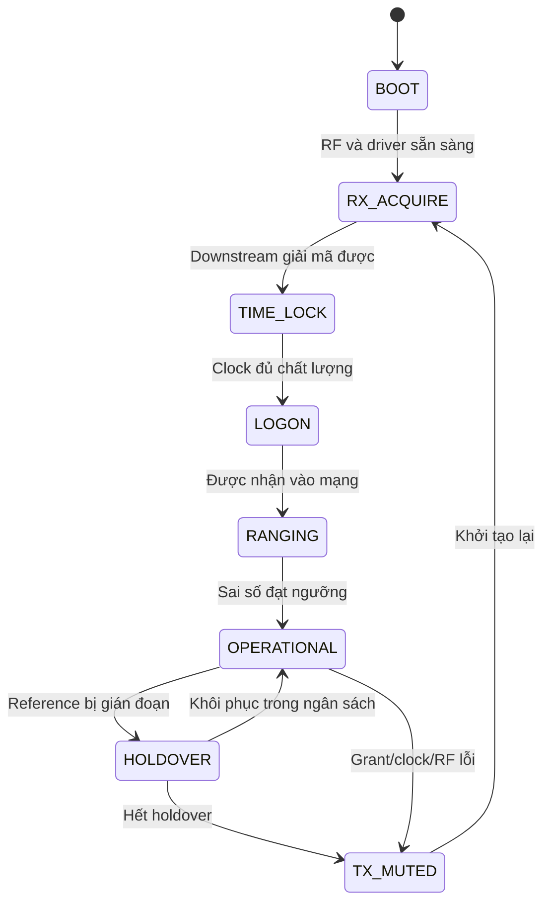

# 06. Phần mềm nhúng, MAC/NCC và quản trị mạng

> **Cập nhật CR-002 — 31/10/2026:** HUB downstream IP cực đại hỗ trợ **≥10 Mbit/s**; VSAT upstream IP cực đại **3 Mbit/s** khi được cấp đủ tài nguyên. Phương án sizing: downstream QPSK 12,5 Msym/s, rate 1/2; upstream QPSK tới 5 Msym/s, một Turbo profile mục tiêu rate 1/2. Đề xuất nâng HUB upstream lên **≥6 Mbit/s tổng/2 carrier**; đây là chỉ tiêu suy ra để phê duyệt, không phải yêu cầu người dùng đã chốt. Các rate thấp chỉ phục vụ bring-up. Xem [baseline tốc độ](../01_Yeu_cau/CR002_Baseline_10M_3M.md); ví dụ số ở rate thấp vẫn là ví dụ, không là trần tốc độ sản phẩm. Tại upstream 5 Msym/s, mục tiêu timing 0,25 symbol tương ứng **50 ns**, phải kiểm chứng lại.

## 1. Vai trò Linux, IIO và custom driver

**Mục đích:** cấu hình RF, vận chuyển packet, quản lý modem và cung cấp dữ liệu chẩn đoán. **Yêu cầu:** build tái lập, trạng thái lỗi rõ, không đưa jitter Linux vào timed TX.

**Phương án:** tái sử dụng ADI Linux/no-OS và HDL phù hợp [S7–S10,S15–S17]. Linux/IIO dùng cấu hình, calibration, test I/Q; custom packet/timed-burst ABI phục vụ đường modem. IIO buffer liên tục không tự tạo grant, timestamp RF hay scheduler MF-TDMA. Không mở raw I/Q DMA debug cùng lúc với đường vận hành nếu tài nguyên chia sẻ chưa được arbitrate.

**Nội dung chi tiết:** đóng băng bộ phiên bản Vivado/HDL/kernel/Device Tree/PetaLinux; quản lý XSA, bitstream, DTB, modules và rootfs như một release thống nhất. Kiểm regmap address, IRQ polarity/routing, DMA phandle, clocks/resets và scan format. Chỉ update Device Tree không sửa được IRQ bị nối sai trong PL.

**Lộ trình:** tháng 1–3 dựng BSP known-good; tháng 3–5 hoàn tất DMA/IRQ/packet driver; tháng 6–12 tích hợp MAC; tháng 13–20 hardening/update/recovery. Không cập nhật toolchain giữa kỳ nếu không có nhánh migration và regression.

## 2. Boot, recovery và cấu hình

Boot chain cần kiểm QSPI/SD, FSBL, U-Boot, bitstream, kernel, DTB và rootfs đúng board. Có board ID và compatibility check trước load firmware. Golden image/recovery boot và rollback khi update lỗi; cập nhật PL/PS theo một manifest version, tránh driver mới điều khiển register map cũ.

Provisioning tối thiểu: network ID, terminal ID/credential, RX carrier bootstrap, vị trí trạm, RF limits, clock mode và IP addressing. Secret không lưu trong log; cấu hình có checksum/version. Phân biệt factory calibration, site config và runtime correction; không ghi correction từng burst xuống flash gây hao mòn.

## 3. DMA, IRQ và queue

| Nội dung | Yêu cầu triển khai | Cách kiểm |
|---|---|---|
| DMA ownership | CPU/device không đồng thời sửa buffer; cache coherent hoặc sync đúng | Pattern test, corruption injection, stress cache |
| Descriptor ring | Head/tail, length, completion, memory barrier, wrap rõ | Vượt vòng hàng triệu packet, reset giữa transfer |
| IRQ | Đường IP→GIC→driver đúng, W1C/ack đúng thứ tự | Counter, ILA, timeout và interrupt storm |
| FIFO | Watermark/overflow/underflow counters có timestamp | Gây stall, xem policy drop/mute đúng |
| Packet driver | MTU, checksum, scatter/gather khi có, bounded queue | Packet sizes và offered load khác nhau |
| Recovery | DMA timeout không treo toàn hệ thống | Hủy descriptors, reset có trật tự, reinit |

Ví dụ 10 Mbit/s ×0,5 s =5 Mbit ≈625 kB payload chờ nếu thiết kế cần giữ nửa giây; chưa tính nhiều queue/packet overhead. Đây là sizing minh họa, không đề nghị mọi packet đều phải đệm một RTT. Queue length phải theo latency và drop policy; cấp RAM vô hạn chỉ làm tăng bufferbloat.

## 4. FSM remote

Mỗi state có entry action, timeout, allowed messages, TX permission, telemetry và exit reason. LOGON/RANGING chỉ có quyền phát trong tài nguyên tương ứng. Hardware interlock là quyền cuối cùng; software state không thể vượt overcurrent hoặc TX inhibit.

## 5. NCC scheduler

### Mục đích và yêu cầu

Cấp các hình chữ nhật tài nguyên trên mặt phẳng thời gian–tần số, đáp ứng nhu cầu và QoS mà không xung đột. Một remote với một TX chain không phát hai carrier cùng lúc. Grant phải đủ lookahead theo file 05, có expiry và epoch; control channel không bị starve.

### Phương án theo giai đoạn

Giai đoạn 1 fixed allocation: bảng khe/carrier tĩnh đủ chứng minh timing. Giai đoạn 2 request–grant: remote báo backlog theo queue, NCC phân bổ dynamic. Giai đoạn 3 QoS: reservation/CIR cho traffic ưu tiên, weighted fairness cho best effort, rate cap và admission khi tổng nhu cầu vượt capacity. Tên thuật toán có thể chọn deficit round-robin hoặc weighted fair allocation; phải mô phỏng trước, không mặc nhiên là thuật toán iDirect.

### Nội dung chi tiết

1. Sổ tài nguyên theo superframe, carrier, burst profile, guard và forbidden intervals.
2. Bảng remote: identity, state, clock/timing quality, RF limits, supported modes, backlog và correction age.
3. Chuyển bytes requested sang số slot theo payload thực, gồm padding/FEC/overhead; không cấp dựa raw bit rate.
4. Scheduler tính lịch tương lai, kiểm xung đột global và từng remote, đóng băng trước deadline.
5. Encoder signalling đóng gói grant; theo dõi sent/ack/applied nếu profile yêu cầu.
6. Phản hồi lỗi: remote không dùng hết grant, quá hạn, stale backlog, outage, retry và resource reclamation.

### Lộ trình và đầu ra

Mô phỏng tháng 2–5; static grants tháng 5–8; dynamic hai carrier tháng 10–14; QoS và tải tháng 14–18. Đầu ra: scheduler source, invariant checker, latency/fairness/capacity report và replay trace.

## 6. Logon, collision và điều khiển truy nhập

Mục đích là cho trạm mới tham gia mà không gây nhiễu trạm đang chạy. Phương án cơ sở: vùng logon riêng có random backoff; tùy lab có thể cấp logon tuần tự có quản trị trước, nhưng chưa được tuyên bố đã giải quyết contention nhiều trạm. Thử cold-start đồng thời và retry limit.

NCC xác minh identity/credential, version và RF capability trước traffic. Cần tách collision, RF failure và authentication failure. Khi logon thất bại, trạm không tăng công suất vô hạn. Sau HUB restart, network epoch đổi và toàn bộ stale grants mất hiệu lực.

## 7. Frequency/power control

Frequency correction dựa CFO HUB đo trên burst, có uncertainty, giới hạn và epoch; ưu tiên NCO correction nhỏ trong PL. Không đồng nhất CFO measured với oscillator remote thuần túy vì còn transponder, BUC/LNB và estimator bias. Đo theo carrier/reference trước tách common-mode và terminal-specific.

Power loop nhằm giữ mức chất lượng/arrival trong miền receiver và bảo vệ spectrum. NCC gửi bước tăng/giảm có giới hạn, remote áp trần EIRP/BUC. Gain loop phải tính trễ GEO và power calibration. Rain fade không luôn được bù bằng tăng BUC: có giới hạn công suất, linearity, uplink/downlink và yêu cầu operator. Dành test saturation, mất feedback và profile thay đổi.

## 8. IP, QoS và hiệu năng GEO

Đề xuất baseline routed IPv4; static routing, ICMP, UDP/TCP, MTU rõ và 2–3 queue. NAT/VLAN/multicast chỉ thêm khi có test cụ thể. UDP throughput đo capacity; TCP throughput chịu RTT, congestion control và loss nên không thể dùng một phép ping làm bằng chứng QoS.

NCC duy trì reservation cho signalling và traffic ưu tiên; remote classifier gắn packet vào queue; grant thực cấp phải phản ánh priority. Đo latency/jitter dưới tải, fairness và queue age. TCP PEP/compression/encryption tương thích là gói riêng; không cam kết tối ưu kiểu X5 nếu chưa làm chủ và đo. Với mã hóa end-to-end, PEP có thể không quan sát được nội dung cần tối ưu; phải xác định policy trước.

## 9. NMS và chẩn đoán

Mỗi remote xuất: firmware/FPGA version, uptime/reset cause, RF settings, measured clock drift, sync state, arrival error histogram, CFO, Rx quality, FEC failures, scheduler/queue counters, DMA/FIFO errors, IFL current/temperature/fault. Phân biệt counter tích lũy và gauge tức thời; có thời điểm reset counter.

NMS có topology/inventory, config validation, alarms, log export và access control. CLI/SSH hoặc API đủ cho baseline; giao diện web là lớp hiển thị, không là nơi giữ trạng thái protocol thời gian thực. Dùng monotonic time cho deadlines và network frame ID cho trace; wall clock phục vụ log con người.

## 10. Bảo mật vận hành

Không tự chế thuật toán mật mã. Dùng thư viện đã được duy trì, chọn phương án authentication, chống replay và key provisioning phù hợp hệ thống. Kiểm chữ ký firmware, phân quyền quản trị, management network isolation, debug disable theo release và rollback policy. Nếu profile riêng dùng message authentication, tính bytes/time overhead vào control capacity.

AES-256 trong brochure không có nghĩa mọi vấn đề security đã giải quyết. Chỉ tiêu riêng cần nêu mode, key lifecycle, nonce/replay, recovery và performance. Secure boot, mã hóa user payload và xác thực grant là ba lớp khác nhau.

## 11. Verification phần mềm

Unit tests tập trung parser, epoch/wrap, resource conflicts, timing correction sign và DMA ownership; integration test driver–PL và state machine faults. Fuzz signalling bằng length/type/version sai; replay trace; đo CPU/RAM under load. Tái tạo một lỗi phải có đủ config, seed, logs, bitstream ID và reference timestamps. Đầu ra source và hướng dẫn build từ máy sạch là một phần nghiệm thu, không chỉ bàn giao rootfs image.
