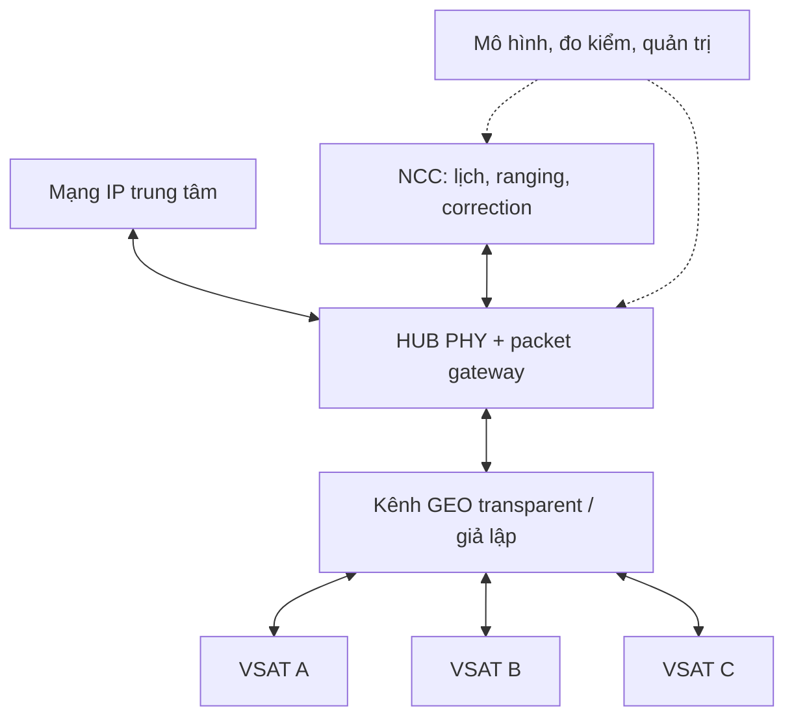
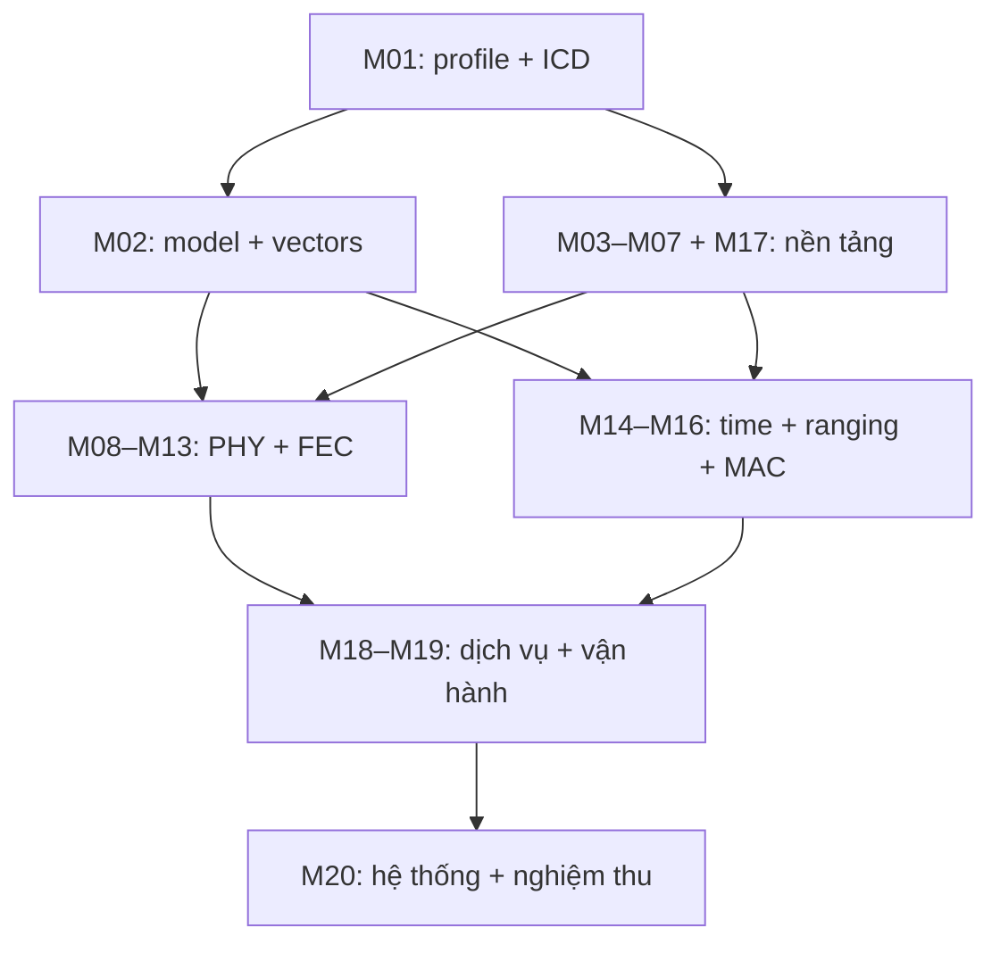

# PHÂN TÍCH YÊU CẦU VÀ PHƯƠNG ÁN KỸ THUẬT HỆ THỐNG MODEM VỆ TINH HUB–VSAT

> **Cập nhật CR-002 — 31/10/2026:** HUB downstream IP cực đại hỗ trợ **≥10 Mbit/s**; VSAT upstream IP cực đại **3 Mbit/s** khi được cấp đủ tài nguyên. Phương án sizing: downstream QPSK 12,5 Msym/s, rate 1/2; upstream QPSK tới 5 Msym/s, một Turbo profile mục tiêu rate 1/2. Đề xuất nâng HUB upstream lên **≥6 Mbit/s tổng/2 carrier**; đây là chỉ tiêu suy ra để phê duyệt, không phải yêu cầu người dùng đã chốt. Các rate thấp chỉ phục vụ bring-up. Xem [baseline tốc độ](../01_Yeu_cau/CR002_Baseline_10M_3M.md); ví dụ số ở rate thấp vẫn là ví dụ, không là trần tốc độ sản phẩm. Tại upstream 5 Msym/s, mục tiêu timing 0,25 symbol tương ứng **50 ns**, phải kiểm chứng lại.

**Phiên bản:** 2.0 — đề xuất thiết kế sơ bộ. **Ngày lập:** 31/10/2026.

**Thời gian nhiệm vụ:** 24 tháng. M1 là tháng đầu kể từ khi khởi động chính thức.

**Đầu vào:** Bảng “Chỉ tiêu tính năng modem HUB và VSAT” đã xây dựng, gồm H01–H56 và V01–V57; bộ phương án nghiên cứu modem vệ tinh 24 tháng. Tài liệu này phân rã yêu cầu thành mô-đun, giao diện, nội dung triển khai và phép kiểm chứng. Không thay thế schematic, RTL, đặc tả waveform hoặc kế hoạch nghiệm thu đã phê duyệt.

## Mục lục

1. Mục tiêu, phạm vi và phân tích yêu cầu.
2. Phương án kỹ thuật chung và lựa chọn công nghệ.
3. Kiến trúc hệ thống và phân chia mô-đun.
4. Phương án kỹ thuật chi tiết của 20 mô-đun.
5. Hợp đồng giao tiếp và trình tự hoạt động.
6. Các ngân sách kỹ thuật và bài toán đồng bộ.
7. Truy vết chỉ tiêu tới mô-đun và kiểm chứng.
8. Nhân lực, phụ thuộc và lộ trình 24 tháng.
9. Kiểm thử, rủi ro, quyết định còn mở và sản phẩm bàn giao.
10. Nguồn tham khảo và thuật ngữ.

---

## 1. Mục tiêu, phạm vi và phân tích yêu cầu

### 1.1. Mục tiêu hệ thống

Xây dựng hệ thống mẫu mạng vệ tinh hình sao gồm một HUB/NCC thử nghiệm và ít nhất ba modem VSAT. HUB phát một carrier downstream DVB-S2 liên tục và thu đồng thời ít nhất hai carrier upstream MF-TDMA. VSAT thu downstream, gia nhập mạng, thực hiện ranging, nhận lịch cấp phát và phát burst đúng thời điểm/tần số được cấp. Hệ thống chuyển IP hai chiều, có QoS cơ bản, giám sát và phục hồi lỗi.

Mục tiêu làm chủ công nghệ được thể hiện qua mô hình, source, RTL, tài liệu giao tiếp, calibration và dữ liệu kiểm thử. Việc truyền được một file hoặc ping qua loopback chỉ là một bước tích hợp, chưa chứng minh toàn bộ chức năng MF-TDMA.

### 1.2. Ranh giới sản phẩm

| Thành phần | Phạm vi nhiệm vụ | Ranh giới cần xác định |
|---|---|---|
| Modem HUB | Downstream TX, upstream multi-carrier RX, packet/control interface | Có thể nhiều board ở prototype; cấu hình cuối phải công bố |
| NCC | Gia nhập, reference/lịch mạng, cấp phát, correction và quản lý trạng thái | Có thể trên máy tính đi kèm HUB; vẫn là đầu ra bắt buộc |
| Modem VSAT | Downstream RX, upstream burst TX, MAC, clock/time và quản trị | Một TX chain phát một carrier tại một thời điểm |
| RF/IFL | IF conditioning, reference, cấp nguồn/bảo vệ ODU theo cấu hình | Tách công suất modem và công suất BUC/LNB |
| BUC/LNB/antenna | Được lựa chọn và tích hợp để thử tuyến | Không mặc nhiên là hạng mục tự nghiên cứu chế tạo |
| Vệ tinh/đường truyền | GEO transparent và kênh giả lập | Thuê tài nguyên, commissioning và điều kiện operator riêng |
| Lab/model | Golden vectors, impairment, traffic, timing/RF measurements | Không dùng emulator packet thay toàn bộ thử waveform |

Phạm vi cơ sở dùng VSAT cố định. Mobility, beam handover, LEO, trải phổ, tối ưu TCP kiểu sản phẩm thương mại, toàn bộ MODCOD và tương thích HUB iDirect là nội dung mở rộng cần đánh giá riêng.

### 1.3. Phân biệt yêu cầu đã định hướng và tham số chưa khóa

| Nhóm | Yêu cầu cơ sở | Hệ quả thiết kế |
|---|---|---|
| Downstream | QPSK, CCM, BCH/LDPC, normal frame, 1/2, 1–12,5 Msym/s | Xây đúng một tập profile nhỏ; thêm mode sau |
| Upstream | QPSK burst, 0,25/0,5/1/2/5 Msym/s; một Turbo TC-LM profile xác định | Phải khóa waveform cụ thể trước RTL/FEC cuối |
| Dung lượng | Downstream IP cực đại ≥10 Mbit/s; VSAT upstream cực đại 3 Mbit/s; đề xuất HUB upstream tổng ≥6 Mbit/s/2 carrier | Đo song công, có accounting overhead |
| Tài nguyên mạng | 3 VSAT vật lý; NCC mô phỏng ≥16 terminal logic | Test RF và test MAC là hai lớp khác nhau |
| Đồng bộ | Ranging closed-loop; mục tiêu arrival error ≤0,25 symbol | Hardware time/timestamp, calibration và delayed-loop control |
| IP/quản trị | MTU 1.500, static routing, 3 lớp QoS, log/config/recovery | Packet driver + MAC queues + quản trị version |
| Độ bền | Soak 72 giờ; nhiệt độ mẫu đề xuất 0 đến +50 °C | Đo thermal, watchdog và lỗi hệ thống |
| Cần khóa | RF levels/mask, CFO range, acquisition time, guard, burst length, IFL power, kích thước | Có owner và deadline, không tự điền số thiếu bằng giả định |

Các mức 0,25 symbol, implementation loss ≤1 dB, throughput và lịch là mục tiêu đề xuất của nhiệm vụ, không phải ngưỡng mặc định của tiêu chuẩn. Chưa có phép đo chứng minh đạt. Việc đổi một mục tiêu phải cập nhật bảng chỉ tiêu và kế hoạch kiểm chứng cùng lúc.

### 1.4. Phân tích tính khả thi và điểm khó

Khả thi có điều kiện ở mức mẫu giới hạn profile nếu có đội chuyên trách, công cụ/lab, IP hoặc năng lực decoder và kiểm chứng sớm. Ba rủi ro chi phối là decoder FEC, burst receiver đa người dùng, và đồng bộ thời gian có propagation/pipeline delay. Linux/BSP và RF/PCB là nền bắt buộc nhưng không giải quyết thay ba rủi ro đó.

Một yêu cầu tốc độ chỉ có ý nghĩa khi chỉ rõ coded bits, information bits hay IP bytes; tốc độ carrier không bằng tốc độ bảo đảm cho mọi VSAT. Tương tự, PLL lock, frame lock, FEC lock và network operational phải là trạng thái riêng. Các định nghĩa này cần thống nhất trước khi giao từng nhóm.

## 2. Phương án kỹ thuật chung và lựa chọn công nghệ

### 2.1. Các quyết định kiến trúc đề xuất

| Hạng mục | Phương án ưu tiên | Cơ sở/lưu ý |
|---|---|---|
| Downstream | DVB-S2 CCM QPSK; BCH ngoài + LDPC trong | Waveform theo [S1]; Turbo không thay FEC DVB-S2 |
| Upstream | MF-TDMA riêng, chọn một waveform TC-LM tham khảo RCS2 | [S2] làm cơ sở; không tuyên bố đầy đủ RCS2 từ tập con |
| Đóng gói IP | Ưu tiên GSE cho downstream khi thư viện/test phù hợp; khóa tại G0 | Nếu dùng TS/private cho prototype phải ghi rõ profile và không gọi là GSE |
| SoC phát triển | Ưu tiên Zynq-7030 | 7020 là phương án tối ưu chi phí sau sizing, không cam kết fit trước synthesis |
| FPGA bổ trợ | Artix-7 A200T là ứng viên FEC/PHY | Chỉ chốt sau PoC tài nguyên, latency và link |
| RF transceiver | AD9361, FDD và sample-rate plan ổn định | RF L-band + BUC/LNB ngoài; xem [S3–S4] |
| Chuyển carrier upstream | NCO/DUC số với LO cố định | Chỉ trong băng tức thời hợp lệ; retune LO là trường hợp riêng |
| HUB đa carrier | Wideband capture + bank DDC cho 2 carrier | PFB/channelizer nâng cao khi cần mở rộng |
| Định thời | Network-time engine và timed TX trong PL | PS nạp lịch sớm, không phát bằng timer userspace |
| FEC | Đánh giá IP thương mại song song PoC tự phát triển | Quyết định trước cuối M4; encoder không thay decoder |
| Embedded | Linux/PetaLinux tương thích ADI HDL/kernel; custom packet/timed ABI | IIO chủ yếu phục vụ cấu hình và diagnostic |
| HUB/NCC mẫu | PC/server chạy NCC, FPGA/SDR xử lý đường thời gian thực | Bàn giao đúng cấu hình thử, không gọi PC là modem độc lập |
| Verification | Float → fixed-point → RTL → IF → GEO delay → vệ tinh | Đối chứng độc lập tại từng boundary |

### 2.2. Phân chia PS, Zynq PL, FPGA phụ và RF

| Miền | Nhiệm vụ chính | Quy tắc thiết kế |
|---|---|---|
| PS/Linux | IP stack, driver, MAC policy, cấu hình, NMS, update | Không giữ deadline RF ở mức từng sample |
| Zynq PL | AD9361 interface, stream/FIFO, timestamp, time engine, launch, phần PHY | Điểm owner của thời gian RF phải duy nhất |
| FPGA phụ | LDPC/BCH hoặc khối PHY nặng theo PoC | Nhận/giao dữ liệu có frame ID, config và backpressure |
| AD9361 | Conversion, rate/filter chain, gain và calibration nội | Không tích hợp DVB-S2/MF-TDMA/NCC |
| RF/IFL | Matching, filter, attenuator/gain, DC/reference injection, bảo vệ | Phải đo level/isolation/spectrum thực |
| HUB host | NCC, multiuser state, logging; có thể decoder software ở PoC thấp tốc | Deadline/backlog phải đo, phần chậm chuyển FPGA khi cần |

Tách thuật toán khỏi nơi thực thi: một decoder có thể bắt đầu trên host để kiểm đúng, nhưng sản phẩm phải đạt throughput/latency trên cấu hình bàn giao. Không kết luận Cortex-A9 đủ tải chỉ vì phần mềm chạy đúng trên PC.

### 2.3. Chiến lược tự phát triển và tái sử dụng

Tự làm chủ timed TX, timestamp/ranging, scheduler, signalling và các giao diện hệ thống. Tái sử dụng HDL/driver ADI theo release phù hợp; dùng GNU Radio/project gốc để đối chứng. Với decoder, chọn mua/tự làm dựa trên bằng chứng FER, throughput worst case, tài nguyên sau routing, quyền dùng/bàn giao và thời gian hỗ trợ. Mọi reuse cần kiểm license theo file/component/commit.

## 3. Kiến trúc hệ thống và phân chia mô-đun

### 3.1. Kiến trúc chức năng

Downstream chở dữ liệu và control/reference. Upstream chở traffic, logon/ranging và request/report theo tài nguyên được quy định. Vùng control phải có capacity bảo đảm khi user traffic quá tải.

### 3.2. Danh mục 20 mô-đun và chủ sở hữu

| Mã | Mô-đun | Vị trí thực thi chính | Chủ trì chuyên môn |
|---|---|---|---|
| M01 | Requirements, profile, ICD và link budget | Hồ sơ/model hệ thống | System architect |
| M02 | Golden model và vector tham chiếu | PC/CI | DSP + verification |
| M03 | Board SoC/FPGA, nguồn, bộ nhớ và DFT | Phần cứng HUB/VSAT | Hardware |
| M04 | RF/IFL và tích hợp ODU | Analog/RF hardware | RF |
| M05 | Physical clock/reference và reset | Clock hardware + PL | Hardware/FPGA |
| M06 | AD9361 interface, calibration và sample transport | RF driver + PL | FPGA/embedded |
| M07 | Liên FPGA | Hai đầu PL/FPGA | FPGA |
| M08 | DVB-S2 TX | HUB PHY | DSP/FPGA |
| M09 | DVB-S2 RX trước FEC | VSAT PL | DSP/FPGA |
| M10 | BCH/LDPC encoder/decoder | HUB encoder, VSAT decoder | FEC/FPGA |
| M11 | Turbo upstream encoder/decoder | VSAT encoder, HUB decoder | FEC |
| M12 | Upstream burst TX | VSAT PL | DSP/FPGA |
| M13 | Multi-carrier burst RX | HUB PL/host | DSP/FPGA |
| M14 | Network time, timestamp và timed TX | HUB/VSAT PL | FPGA + system |
| M15 | Ranging, frequency/power control | NCC + VSAT control | MAC/DSP/system |
| M16 | MAC, signalling, logon và scheduler | NCC + VSAT | MAC/network |
| M17 | Linux/BSP, DMA và packet driver | PS và HUB host | Embedded |
| M18 | Encapsulation, IP và QoS | PS/PL packet boundary | Network/embedded |
| M19 | NMS, security, update và recovery | HUB/VSAT software | Embedded/tooling |
| M20 | Integration, calibration và acceptance | Lab, CI, hiện trường | Verification/integration |

M05 quản lý clock vật lý; M14 biểu diễn/đồng bộ thời gian logic; M15 điều khiển lỗi arrival. Ba mô-đun phối hợp nhưng không cùng làm một việc. M09 kết thúc ở soft bits; M10 xử lý FEC để có thể thay/mua decoder mà không viết lại receiver.

## 4. Phương án kỹ thuật chi tiết từng mô-đun

### M01 — Phân tích yêu cầu, profile, ICD và quỹ đường truyền

**Mục đích:** tạo cơ sở thống nhất cho mọi nhóm và biến chỉ tiêu thành cấu hình đo được.

**Đầu vào/đầu ra:** đầu vào là bảng H/V, topology, ODU và tài nguyên vệ tinh; đầu ra gồm SRS, profile matrix, ICD, timing/rate/level budgets và verification mapping.

**Yêu cầu kỹ thuật:** phân biệt chuẩn và giao thức riêng, IP/carrier rate, điểm timestamp, đơn vị/dấu, bit order/endian và điều kiện lỗi. Mỗi TBD có owner, thời hạn và dữ liệu cần để chốt. Quỹ đường truyền phải tính riêng hai hướng, không tự gán margin/availability khi thiếu EIRP/G/T và tuyến.

**Phương án/chi tiết:** đọc [S1–S3]; chọn một cấu hình cơ sở; kiểm tổng overhead đạt 10/6 Mbit/s; lập ma trận valid combinations; thống nhất RF reference plane; tính C/N0/EsN0 theo cùng định nghĩa, cộng implementation margin sau khi đo. Chốt encapsulation và waveform upstream bằng decision record.

**Kiểm chứng/đầu ra bàn giao:** review liên ngành; từng chỉ tiêu có phép đo và không có cặp yêu cầu mâu thuẫn. Link budget có input provenance, giả thiết và sensitivity analysis.

**Lộ trình/phụ thuộc:** M1–M2 baseline; M3–M4 đóng các sizing quan trọng; cập nhật tại mỗi gate. System architect chủ trì; là đầu vào của tất cả mô-đun.

### M02 — Mô hình tham chiếu và test vectors

**Mục đích:** có chuẩn kiểm tra độc lập cho thuật toán, fixed-point và RTL.

**Đầu vào/đầu ra:** payload/config/channel seed → encoded bits, symbols, I/Q, LLR, decoded payload và metadata mong đợi.

**Yêu cầu kỹ thuật:** lặp lại được, có version, vector tại boundary; bao phủ sạch/nhiễu, CFO, fractional delay, clock drift, phase noise và nhiều burst. Model không được dùng cùng một implementation sai ở cả hai đầu rồi coi tự tương thích là đúng.

**Phương án/chi tiết:** Python/C++ và project GNU Radio [S8–S9] cho đối chứng; floating-point trước, fixed-point bit-accurate sau. Lưu scaling, q-format, endian, seed và expected output; tạo scripts FER/EVM/timing. Khi model và RTL khác nhau phải xác định boundary đầu tiên lệch.

**Kiểm chứng/đầu ra bàn giao:** clean-channel bit exact; ít nhất một nguồn encoder/transmitter độc lập; baseline curves có confidence/sample count; bộ vector regression cho CI.

**Lộ trình/phụ thuộc:** M1–M4 nền; M5–M16 thêm impairment/profile và fault tests. DSP + QA; cần M01 profile, hỗ trợ toàn bộ PHY và control.

### M03 — Board SoC/FPGA, nguồn, bộ nhớ và khả năng kiểm tra

**Mục đích:** tạo nền tích hợp có thể bring-up, đo và sửa lỗi.

**Đầu vào/đầu ra:** yêu cầu compute/IO/power/thermal → schematic/layout/BOM, board và manufacturing tests.

**Yêu cầu kỹ thuật:** Ethernet Gigabit, DDR, boot storage, JTAG/console, board ID, power/temperature monitoring; đúng bank voltage/pin/package. Có recovery boot và đường nạp FPGA phụ khi link chưa lên. Mục tiêu nhiệt độ mẫu 0–50 °C và soak 72 giờ cần đo thực tế.

**Phương án/chi tiết:** dùng dev board trước; ưu tiên 7030, xem 7020 theo sizing. Thêm A200T khi M07/M10 có bằng chứng lợi ích. Kiểm rail sequencing, supervisor, decoupling, DDR SI/PI, thermal và clock placement; bố trí testpoint, loopback/PRBS và current measurement. Thực hiện review pin/bank trước layout.

**Kiểm chứng/đầu ra bàn giao:** rail/reset/DDR/Ethernet stress, JTAG recovery, thermal at load; CAD/BOM/Gerber, bring-up guide và DFT checklist. Không phát hành PCB chỉ từ sơ đồ khối.

**Lộ trình/phụ thuộc:** M1–M6 dev board/sizing; M7–M12 PCB vòng 1 sau G1; M15–M18 vòng 2; M19–M21 xác nhận sửa. Hardware; phụ thuộc M01/M05/M07/M10.

### M04 — RF/IFL và tích hợp BUC/LNB

**Mục đích:** nối AD9361 với miền IF vệ tinh an toàn, đúng level và chất lượng RF.

**Đầu vào/đầu ra:** RF port AD9361, ODU/reference/power → IF RX/TX, DC/reference feed và telemetry fault.

**Yêu cầu kỹ thuật:** định hướng RX 950–2.150 MHz, TX 950–1.700 MHz theo ODU; RX/TX riêng; prototype ưu tiên 50 Ω. Quy định input composite, output range, spur/mask, matching, FDD desense và bảo vệ DC. Đầu nối/trở kháng final phải khóa trong ICD.

**Phương án/chi tiết:** matching/balun/filter, gain/attenuator, shielding và layout cách ly; bias tee/10 MHz injection riêng. Chọn eFuse/current limit và surge/ESD theo điện áp/dòng BUC/LNB; đo cable loss, startup current, thermal. Không để nguồn ODU đi vào port AD9361; kiểm BUC back-off và transient bằng waveform burst.

**Kiểm chứng/đầu ra bàn giao:** level calibration, return loss, spectrum, blocking, RX trong lúc TX; trip/fault/recovery của IFL. Báo cáo RF theo reference plane và procedure calibration.

**Lộ trình/phụ thuộc:** M1–M3 level plan; M4–M8 module thử; M9–M18 tích hợp PCB; M19–M22 xác nhận. RF/hardware; cần ODU plan, M03/M05/M12/M13.

### M05 — Clock vật lý, reference và reset

**Mục đích:** cung cấp clock ổn định và startup/reset nhất quán.

**Đầu vào/đầu ra:** TCXO/OCXO hoặc reference ngoài → clocks cho AD9361, PL/FPGA và trạng thái reference-valid/reset.

**Yêu cầu kỹ thuật:** frequency stability và phase noise phù hợp; reset release đồng bộ theo domain, phát hiện mất clock. HUB có ngõ reference 10 MHz; VSAT khuyến nghị reference/PPS để thử. Không mặc định cấp trực tiếp 10 MHz vào mọi clock input.

**Phương án/chi tiết:** clock tree dựa [S3–S4]; chọn sample rate dùng chung hợp lệ cho hai chiều, DDC/DUC tạo rate cần thiết. Lập clock-domain map, clock/reset constraints, oscillator drift budget; dùng MMCM/PLL/clock synthesizer đúng dải. Sync mất reference dẫn tới logic holdover của M14, không tự giữ TX permit vô hạn.

**Kiểm chứng/đầu ra bàn giao:** đo frequency/drift/jitter/lock và reset nhiều lần; kiểm valid signals và không có metastability/reset violation chưa xử lý. Clock plan, constraints và báo cáo calibration.

**Lộ trình/phụ thuộc:** M1–M4 plan/PoC; M5–M9 clock độc lập; M10–M18 đo theo nhiệt/config. Hardware/FPGA; liên quan M03/M06/M14.

### M06 — AD9361 interface, điều khiển và luồng sample

**Mục đích:** trao đổi I/Q liên tục và cấu hình RF tin cậy.

**Đầu vào/đầu ra:** LVDS/CMOS + SPI/control ↔ I/Q stream có sample-valid, status và diagnostic capture.

**Yêu cầu kỹ thuật:** chọn mode FDD và port/rate chain hợp lệ; đúng I/Q order, sign, channel packing và bit width; FIFO/CDC rõ. Không dừng được RF sampling chỉ vì downstream AXI ready hạ. Reset/calibration không được bất ngờ xảy ra trong traffic.

**Phương án/chi tiết:** tái sử dụng ADI `axi_ad9361` và design nền [S4–S5] theo release đã khóa. Bring-up SPI → PN/LVDS → DDS/capture → external loopback → FDD. Giữ stream trong PL cho đường modem, raw I/Q DMA chỉ để debug/capture có arbitration. Lưu config/filter version vì group delay phụ thuộc cấu hình.

**Kiểm chứng/đầu ra bàn giao:** PN/pattern pass, I/Q integrity, không mất sample ở valid rate, reset/recovery được; ILA và captures xác minh interface. Source/config và hướng dẫn bring-up.

**Lộ trình/phụ thuộc:** M1–M4 nền; M5–M8 ổn định; M9–M18 tích hợp board. FPGA/embedded; cần M03/M05/M17.

### M07 — Giao tiếp liên FPGA

**Mục đích:** mở rộng FEC/PHY mà không tạo bottleneck hay phá timing.

**Đầu vào/đầu ra:** stream I/Q hoặc LLR/codeblock + metadata ↔ payload/result, credits và link status.

**Yêu cầu kỹ thuật:** throughput đủ worst case, CRC/sequence/config version, backpressure và reset recovery. Có link epoch chống dùng dữ liệu trước reset. Không để arrival của packet trên link biến thiên quyết định mốc RF launch.

**Phương án/chi tiết:** với 7030, khảo sát GTX↔GTP/Aurora hoặc serial protocol có cấu hình tương thích hai đầu; 7020 dùng SelectIO source-synchronous phù hợp [S7]. Thử LLR boundary để giảm traffic so raw I/Q. PRBS/training, frame types, credits, async FIFO và error counters. Không coi GTX maximum là tốc độ hai chip/PCB đã đạt.

**Kiểm chứng/đầu ra bàn giao:** payload bandwidth, max stall/latency, bit/packet errors, reset/retraining ở tải/nhiệt; protocol spec, constraints và loopback fixture. Nếu không cần FPGA phụ, ghi module không áp dụng ở cấu hình đó.

**Lộ trình/phụ thuộc:** M2–M4 PoC và partition gate; M5–M8 tích hợp; M9–M18 board verification. FPGA; cần M01/M03/M10.

### M08 — Bộ phát DVB-S2 tại HUB

**Mục đích:** phát downstream chuẩn, liên tục, chở IP và control.

**Đầu vào/đầu ra:** encapsulated packets/config/reference association → waveform I/Q và frame marker/ID.

**Yêu cầu kỹ thuật:** profile QPSK, CCM, normal frame/rate 1/2, pilot, roll-off 0,25 và Rs 1/2/5/12,5 Msym/s. Waveform theo [S1]. Reference phải liên kết đúng marker RF, không dùng thời điểm packet vào queue.

**Phương án/chi tiết:** packet framing → M10 encoder → mapping/PL framing → shaping/rate conversion → M06. Chuẩn bị SDR TX tham chiếu độc lập sớm; triển khai TX sản phẩm và đối chiếu. Duy trì waveform khi queue rỗng theo chế độ hợp lệ; kiểm metadata xuyên pipeline.

**Kiểm chứng/đầu ra bàn giao:** bits/symbol/frame markers đúng vector, spectrum/EVM theo test plan, VSAT/reference receiver thu được; continuous TX không mất mẫu. Source, vectors và waveform report.

**Lộ trình/phụ thuộc:** M2–M5 nguồn đối chứng; M5–M10 tích hợp TX; M11–M16 load/config; mode mở rộng sau G3. DSP/FPGA; M02/M06/M10/M18.

### M09 — Bộ thu DVB-S2 tại VSAT trước FEC

**Mục đích:** bắt/bám tín hiệu downstream và sinh soft bits đủ chất lượng.

**Đầu vào/đầu ra:** I/Q samples → LLR, frame/config metadata và timestamp marker trước FEC.

**Yêu cầu kỹ thuật:** hỗ trợ profile HUB; acquisition/tracking symbol, frame, carrier/phase; LLR đúng dấu/thang; có status riêng từng tầng. Miền CFO/drift/SNR và thời gian bắt phải được khóa sau model, không đặt ngẫu nhiên.

**Phương án/chi tiết:** DDC/resampling/RRC; coarse CFO; timing estimator/interpolator; frame/PLS detection; pilot-aided phase/frequency tracking; soft demap. Khảo sát Gardner/Farrow hoặc thuật toán tương đương phù hợp rate và oversampling; tuning acquisition khác tracking. Quantization qua float→fixed sweep, chống false lock/cycle slip.

**Kiểm chứng/đầu ra bàn giao:** acquisition probability/time, miss/false lock, LLR accuracy, FER cùng M10; đối chứng [S8]. Không sửa decoder để che LLR sai. RTL/model và trace tại boundaries.

**Lộ trình/phụ thuộc:** M2–M4 model; M4–M8 QPSK baseline; M9–M14 impairment/tải; M15–M18 mở rộng có gate. DSP/FPGA; M02/M06/M10/M14.

### M10 — FEC BCH/LDPC downstream

**Mục đích:** mã hóa tại HUB và giải mã tại VSAT đúng profile, đủ tốc độ liên tục.

**Đầu vào/đầu ra:** HUB: frame bits → coded bits; VSAT: ordered LLR + config → recovered bits và decode status.

**Yêu cầu kỹ thuật:** đúng normal FECFRAME/rate 1/2; throughput worst case với max iterations; BRAM/message bandwidth đủ; BCH không bị bỏ; status uncorrectable rõ. FPGA resource/Fmax phải có place-and-route evidence, không chỉ số LUT ước tính.

**Phương án/chi tiết:** đánh giá core thương mại và PoC nội bộ; nếu tự làm khảo sát layered normalized/offset min-sum, banking, saturation, early stop. Chọn soft width từ FER/resource trade-off; kiểm parity và permutation độc lập. Giao tiếp frame-ID giữ từ LLR đến output, queue đôi để không tràn.

**Kiểm chứng/đầu ra bàn giao:** vectors độc lập; FER vs reference, max-iteration throughput, timing closure và memory utilization. License/source/binary/constraints theo phương án mua; không hứa làm chủ source phần black box.

**Lộ trình/phụ thuộc:** M1–M4 quyết định buy/build và PoC; M5–M10 tích hợp; M11–M14 worst case. FEC/FPGA; cần M01/M02, phối hợp M07/M09.

### M11 — FEC Turbo upstream

**Mục đích:** bảo vệ burst return với một waveform xác định và decoder HUB đủ backlog.

**Đầu vào/đầu ra:** VSAT packet/codeblock → encoded stream; HUB soft stream → payload và CRC/status.

**Yêu cầu kỹ thuật:** chính xác họ mã, interleaver, puncturing, termination/circulation, block size và mapping. Không dùng core Turbo LTE hoặc Turbo product code rồi mặc định tương thích TC-LM. Rate 1/2 chỉ khóa nếu hợp lệ trong waveform đã chọn.

**Phương án/chi tiết:** encoder ở VSAT PL; decoder HUB software ở PoC thấp tốc, sau đó FPGA hoặc host tối ưu nếu chứng minh đạt. Model kiểm từng permutation/bit order, quantization và iteration. Tính worst-case số burst/giây và max decoder queue cho hai carrier, không dùng benchmark một burst đơn.

**Kiểm chứng/đầu ra bàn giao:** golden vectors, BER/FER, profile sheet, latency/iteration/backlog report. Nếu thay FEC khác phải quản lý thay đổi chỉ tiêu H27–H28/V27–V28 và peer waveform.

**Lộ trình/phụ thuộc:** M2–M4 chọn profile/PoC; M5–M6 vectors; M7–M10 realtime; M11–M14 dual-carrier stress. FEC + HUB implementation; M01/M02/M12/M13.

### M12 — Bộ phát burst upstream tại VSAT

**Mục đích:** tạo burst đúng dữ liệu, tần số, thời gian và envelope được cấp.

**Đầu vào/đầu ra:** payload/config/grant → prebuilt symbols/waveform → timed I/Q; completion/error record.

**Yêu cầu kỹ thuật:** QPSK 0,25/0,5/1/2/5 Msym/s; preamble/FEC/CRC/tail đúng profile; đầy buffer trước arm, không phát muộn khi thiếu dữ liệu. NCO đổi carrier trong băng hợp lệ; một TX chain không phát hai carrier cùng lúc.

**Phương án/chi tiết:** packet packer → M11 → burst builder → RRC/interpolator → NCO/envelope → timed gate M14 → M06. Tính filter delay/tails; flush có kiểm soát; descriptor giới hạn duration và power. Áp correction theo epoch trước launch, không sửa waveform/config khi đang phát.

**Kiểm chứng/đầu ra bàn giao:** payload/CRC đúng, RF launch và end envelope đúng grant, carrier/ACPR/ramp đo được, duplicate/late descriptor bị từ chối. RTL/vector và RF burst captures.

**Lộ trình/phụ thuộc:** M3–M6 burst debug; M7–M10 FEC/timed; M11–M14 đổi carrier và RF tails. FPGA/DSP; M06/M11/M14/M16.

### M13 — Bộ thu burst đa carrier tại HUB

**Mục đích:** thu đồng thời burst từ các VSAT có timing, CFO, phase và power khác nhau.

**Đầu vào/đầu ra:** wideband I/Q + schedule hints → payload từng burst và đo arrival/CFO/quality.

**Yêu cầu kỹ thuật:** ít nhất 2 carrier đồng thời, 3 VSAT, detector không nhận nhầm identity; timestamp quy về cùng reference plane; không tái dùng mù phase/AGC của trạm trước. Carrier gain không được làm ADC clipping vì near-far.

**Phương án/chi tiết:** fixed wideband gain hợp lý → bank DDC/decimation → UW correlation → data-aided CFO/timing/phase → matched filter/soft demap → M11 → CRC/reassembly. Dành search window rộng cho logon và hẹp cho traffic; prior estimates theo terminal có expiry. Khi dynamic range không đủ phải điều chỉnh RF/phân receiver.

**Kiểm chứng/đầu ra bàn giao:** simultaneous captures/decoded streams; probability of detection/false alarm, near-far/blocker, back-to-back decoder load, fractional timing bias calibration. Model/RTL/host source và burst reports.

**Lộ trình/phụ thuộc:** M3–M6 một carrier; M7–M12 hai carrier/FEC; M13–M16 near-far/load; M17–M20 hardware final. DSP/FPGA; M02/M06/M11/M14.

### M14 — Network time, hardware timestamp và timed TX

**Mục đích:** nối timeline mạng với sự kiện sample/RF một cách xác định.

**Đầu vào/đầu ra:** PHY marker/reference, calibrated delay và descriptor → local network-time estimate, timestamp records, timed launch và TX permit.

**Yêu cầu kỹ thuật:** counter monotonic, integer/fractional precision phù hợp, epoch/wrap-safe, CDC đúng; timestamp trước latency FEC biến thiên; correction không làm phát descriptor hai lần. Linux chỉ nạp sớm; PL tự kiểm deadline và đóng TX.

**Phương án/chi tiết:** HUB đánh số marker và association reference; VSAT lưu sample event theo frame ID trước FEC, sau decode ghép reference để bám offset/rate bằng accumulator/DPLL. State UNLOCKED/ACQUIRE/LOCKED/HOLDOVER/UNSYNC. Double-buffer schedule, atomic commit; launch theo counter sau trừ latency calibration. Mất clock/grant/config/IFL permit dẫn mute.

**Kiểm chứng/đầu ra bàn giao:** test epoch/wrap, late/duplicate, reset, backpressure; đo RF jitter/latency khác với timestamp resolution; drift/holdover sweep. Time ICD, RTL và calibration tables.

**Lộ trình/phụ thuộc:** M2–M5 engine/PoC; M6–M9 clock độc lập; M10–M16 calibration/robustness. FPGA/system; M05/M06/M08/M09/M12/M13.

### M15 — Ranging và vòng điều khiển timing/frequency/power

**Mục đích:** khép vòng để burst từng VSAT đến đúng khe và chất lượng đủ tốt.

**Đầu vào/đầu ra:** expected/actual arrival, CFO, quality, identity và location → correction có epoch; residual/health report.

**Yêu cầu kỹ thuật:** lỗi/dấu/unit rõ, correction chỉ áp một lần, đo thuộc đúng grant/config, có outlier/age checks và giới hạn bước. Control stability phải xét feedback GEO; bù hình học chỉ thô.

**Phương án/chi tiết:** logon có cửa sổ riêng; range theo ECEF khi có vị trí; đo burst data-aided; `e=arrival_measured−arrival_target`, e dương nghĩa muộn, tăng advance để phát sớm. Ban đầu một correction chưa xác nhận mỗi terminal; sau nâng estimator offset/drift và prediction tới effective epoch. Frequency/power có limits và anti-windup/clamp, không tăng power vô hạn khi mất feedback.

**Kiểm chứng/đầu ra bàn giao:** hai remote khác delay hội tụ đúng, drift và delayed feedback không dao động, reject wrong-ID/stale reports; residual target ≤0,25 symbol theo điều kiện. Model/loop parameters, trace và failure policy.

**Lộ trình/phụ thuộc:** M2–M5 model; M6–M9 ranging hai trạm; M10–M16 multiuser/control; M17–M20 RF thực. MAC/system/DSP; M13/M14/M16.

### M16 — MAC, signalling, logon và NCC scheduler

**Mục đích:** quản lý vòng đời terminal và chia tài nguyên đúng nhu cầu/QoS.

**Đầu vào/đầu ra:** terminal state/backlog, resource map/corrections → grants, messages và telemetry.

**Yêu cầu kỹ thuật:** cấp đủ lookahead, không xung đột theo carrier và từng TX chain, control không starve, grant có ID/epoch/expiry. Parser bounded và versioned; logon collision/backoff riêng; ít nhất 16 terminal logic trong simulator.

**Phương án/chi tiết:** static schedule → request/grant → reservation/priority + weighted fairness. Resource ledger tính slots theo payload thực/guard/FEC; schedule double-buffer. VSAT FSM BOOT→RX_ACQUIRE→TIME_LOCK→LOGON→RANGING→OPERATIONAL, có HOLDOVER/TX_MUTED. Chọn message riêng có CRC/auth/replay rules; nếu triển khai RCS2 thay bằng signalling chuẩn phù hợp, không chỉ đổi tên.

**Kiểm chứng/đầu ra bàn giao:** invariant checker không overlap; oversubscription/admission, simultaneous logon, lost/reordered grants và HUB restart. Source, message spec, simulator và replay traces.

**Lộ trình/phụ thuộc:** M2–M5 simulator; M6–M12 static/logon; M13–M18 dynamic/QoS. MAC/network; M01/M14/M15/M18.

### M17 — Linux/BSP, PS–PL, DMA và packet driver

**Mục đích:** vận chuyển packet/control và cung cấp nền software ổn định.

**Đầu vào/đầu ra:** XSA/bitstream/DT và hardware rings → kernel interfaces, buffers, completion/IRQ và app API.

**Yêu cầu kỹ thuật:** toolchain/release tương thích; regmap/IRQ/clocks/reset đúng; cache ownership và barriers rõ; bounded DMA ring, timeout/recovery. IIO dùng cấu hình/diagnostic, không tự thay timed-burst ABI.

**Phương án/chi tiết:** ADI Linux/no-OS/libiio theo release; PetaLinux tích hợp driver/DT tương thích. Test IRQ IP→GIC→driver, pattern DMA→real I/Q, coherent/streaming mappings theo kernel API. Custom packet/timed control driver với producer/consumer và cancel/reset states; rate-limit IRQ/log. Release bundle gắn driver ABI với FPGA build ID.

**Kiểm chứng/đầu ra bàn giao:** cache stress, ring wrap, MTU/length faults, timeout, reset dưới tải, build từ máy sạch. Source/BSP/DT và report IRQ/DMA/CPU/RAM. Xem [S6,S10–S11].

**Lộ trình/phụ thuộc:** M1–M4 bring-up; M5–M8 packet ABI; M9–M18 hardening; M19–M22 release. Embedded/FPGA; M03/M06/M14.

### M18 — Encapsulation, IP datapath và QoS

**Mục đích:** vận chuyển IP đúng MTU và chuyển yêu cầu dịch vụ thành nhu cầu tài nguyên.

**Đầu vào/đầu ra:** Ethernet/IP packets ↔ GSE hoặc encapsulation profile, upstream payload fragments và queue reports.

**Yêu cầu kỹ thuật:** IPv4/ICMP/UDP/TCP, static route, MTU 1.500, ít nhất 3 queue; fragmentation/reassembly bounded, chống stale fragments. Hạch toán throughput theo IP bytes, không tính padding/FEC.

**Phương án/chi tiết:** ưu tiên GSE downstream khi G0 xác nhận implementation/test [S12]; upstream packing theo burst profile riêng. Classifier theo policy, reservation signalling, priority cho traffic quan trọng và fairness best effort. Giới hạn queue theo latency/memory, report backlog có age; không buffer vô hạn để che thiếu grant. TCP performance đo riêng do RTT/loss.

**Kiểm chứng/đầu ra bàn giao:** packet sizes, fragmentation loss/reorder, checksum/MTU, simultaneous throughput, queue overload/fairness và control reservation. API/spec, source và capacity accounting report.

**Lộ trình/phụ thuộc:** M2–M4 encapsulation decision; M5–M10 IP path; M11–M18 QoS/stress. Embedded/network; M08/M10/M11/M16/M17.

### M19 — NMS, bảo mật, update và recovery

**Mục đích:** vận hành, phát hiện lỗi và phục hồi đúng cấu hình.

**Đầu vào/đầu ra:** counters/config/release/credentials ↔ CLI/SSH/API, alarms, logs, signed update và recovery actions.

**Yêu cầu kỹ thuật:** inventory/version, phân quyền, lưu cấu hình, credential protection, replay defense cho control theo profile, watchdog và rollback. Không ghi correction từng burst xuống flash. Secure boot, firmware authentication và user encryption là phạm vi khác nhau.

**Phương án/chi tiết:** daemon/API/CLI trước UI; counter/gauge schema thống nhất; manifest kiểm board/ABI/FPGA/software trước update; golden recovery image. Dùng thư viện mật mã duy trì, xác định key/nonce lifecycle thay vì tự chế cipher. Tách calibration, provisioning và runtime state; lỗi NMS không được mở TX permit.

**Kiểm chứng/đầu ra bàn giao:** unauthorized action, replay/duplicate, corrupt update/cúp nguồn/rollback, secrets không rò log, watchdog treo userspace; runbook, manifest và recovery test.

**Lộ trình/phụ thuộc:** M5–M10 telemetry; M11–M18 management/security/update; M19–M22 hardening. Embedded/tooling; M03/M16/M17/M20.

### M20 — Tích hợp, calibration và kiểm chứng nghiệm thu

**Mục đích:** chứng minh toàn bộ chỉ tiêu H/V trên cấu hình bàn giao.

**Đầu vào/đầu ra:** DUT/model/ICD/test cases/lab → calibrated results, incident closure và acceptance package.

**Yêu cầu kỹ thuật:** independent reference, traceable config, PHY/MAC/packet tests tách lớp; đủ 3 VSAT/2 carrier, clock độc lập, GEO delay, FDD/near-far, fault injection và soak. Không dùng một lần live demo để suy availability.

**Phương án/chi tiết:** thiết lập fixture/automation sớm, golden transmit/receive paths; unit→SIL→RTL→IF→impaired IF→GEO→live. Calibration timing/RF theo config và nhiệt/reset; lưu sample/LLR/packet/grant traces. Lab emulator waveform có đủ DDR/bandwidth và đo jitter riêng.

**Kiểm chứng/đầu ra bàn giao:** test plan/pass-fail/raw records, uncertainty/calibration, known limitations, build-from-clean-machine và lặp test bởi người tiếp nhận. Mọi kết quả gắn serial/build/profile/seed.

**Lộ trình/phụ thuộc:** M1 test plan, M4–M12 block/integration, M13–M20 system, M21–M23 live/soak, M24 handover. QA/integration; bao phủ tất cả mô-đun.

## 5. Hợp đồng giao tiếp và trình tự hoạt động

### 5.1. Danh mục ICD phải phát hành

| ICD | Hai phía/giao diện | Nội dung tối thiểu | Owner và thời điểm |
|---|---|---|---|
| ICD-01 RF/IFL | M04 ↔ M06/ODU | Tần số, level/reference plane, impedance, DC/reference, fault, calibration | RF; draft M2, khóa trước PCB |
| ICD-02 Clock/Time | M05/M14/M15 ↔ PHY/MAC | Clock domains, epoch, timestamp marker, delay/sign/unit, holdover | System/FPGA; M2–M4 |
| ICD-03 PS–PL ABI | M17 ↔ PL/M16 | Register map, build ID, rings, descriptor, IRQ/ack, barriers, reset | Embedded/FPGA; M2–M4 |
| ICD-04 Liên FPGA | M07 ↔ M09/M10 | Frame types, ordering, flow control, latency, CRC, link epoch | FPGA; M3–M4 |
| ICD-05 Waveform/FEC | M08–M13 | Bit/symbol order, frame/burst, codeblock, normalization, q-format, filters | DSP/FEC; M2–M4 |
| ICD-06 Network/control | M15/M16/M18 | Message schema, states, grants/corrections, fragmentation, auth/replay | MAC; M2–M4 |
| ICD-07 Telemetry/test | M19/M20 ↔ mọi mô-đun | Units, counter reset, timestamps, trace schema và calibration version | QA/tooling; M3–M5 |

Không thay đổi clock/rate/profile qua một register riêng lẻ khi traffic đang chạy. Dùng shadow config và commit epoch; validate cross-field constraints trước arm. Mỗi ABI có major/minor version; major mismatch từ chối hoạt động, không cố chạy đoán register layout.

### 5.2. Định nghĩa dữ liệu tại các boundary

| Record | Trường đề xuất | Bảo đảm bắt buộc |
|---|---|---|
| `sample_record` | I, Q, sample index, channel, valid/config ID khi cần | Thứ tự và scaling rõ; gap/overflow phải báo |
| `llr_frame` | Frame ID, MODCOD/frame length, q-format, LLR count, payload LLR | Đủ độ dài, đúng thứ tự; không ghép hai frame khác |
| `tx_descriptor` | Epoch, grant/terminal ID, launch integer/fraction, carrier/rate/waveform ID, length/buffer, power/ramp, CRC | Deadline, whitelist và buffer sẵn sàng được kiểm trước accept |
| `tx_completion` | Grant ID, accepted/launched/completed hoặc reject reason, launch timestamp, underflow flags | Mỗi grant chỉ completion một lần theo state |
| `rx_burst_report` | Carrier, expected grant/detected ID, arrival integer/fraction, CFO, quality, payload/CRC/FEC, config ID | Unknown logon không gán nhầm terminal; quality của timing riêng |
| `correction` | Terminal, measurement epoch, sequence, effective epoch, delta/time unit, CFO/power, validity | Áp một lần, đúng thứ tự/quy tắc tuổi dữ liệu |
| `reference_event` | Network epoch, PHY marker/frame ID, reference time, local timestamp, calibration ID | Ghép đúng marker dù FEC/queue latency thay đổi |

Tên trường trên là đề xuất cho giao thức riêng, không phải nguyên mẫu bitfield ETSI. Field widths/endianness/CRC polynomial nằm trong ICD sau PoC. AXI stream dùng valid/ready chuẩn ở các boundary có thể stall; đường sample RF không thể bị dừng tùy ý. Metadata phải qua CDC cùng record/FIFO, không sync rời từng bit counter đa bit.

### 5.3. Trình tự khởi tạo và gia nhập

1. Boot/recovery kiểm board ID và software/FPGA compatibility; mặc định TX inhibit.
2. Clock/reference ổn định, release reset từng domain; AD9361 init/calibration; self-test interface/DMA.
3. VSAT bắt downstream và giải mã profile; báo riêng PL/FEC lock.
4. Ghép PHY marker với reference; bám network rate/epoch; đánh giá clock quality.
5. VSAT logon trong tài nguyên riêng; NCC xác minh identity/capability và cấp ranging.
6. Ranging thô/tinh hội tụ; control state đủ tin cậy mới chuyển operational.
7. VSAT báo backlog; NCC cấp grant tương lai; payload chuẩn bị và PL thực thi.
8. Theo dõi residual/CFO/quality; corrections áp tại epoch; mất điều kiện dẫn holdover hoặc mute.

### 5.4. Trình tự một burst traffic

PS lấy packet theo QoS → pack/FEC trước deadline → ghi descriptor/buffer ownership → PL validate → accepted/armed → chờ counter → launch RF → giới hạn duration/tail → completion → HUB nhận/đo/giải mã → chuyển IP và report NCC. Nếu payload chưa đủ hoặc grant quá hạn, từ chối phát và ghi lý do; không “gửi bù muộn”.

### 5.5. Các bất biến hệ thống phải kiểm tự động

- `TX_allowed = clock_valid AND grant_valid AND epoch_match AND waveform_ready AND RF_permit AND NOT fault`.
- Một terminal với một TX chain không có hai khoảng phát chồng nhau, kể cả khác carrier.
- Mỗi grant tiêu thụ tối đa một lần; reset làm vô hiệu toàn bộ grant/link epoch cũ.
- Một reference/correction luôn gắn marker/config phù hợp; không đo ở cấu hình A rồi sửa cấu hình B mà không chuyển đổi.
- Không giao payload lỗi/unknown status lên IP như packet hợp lệ; không giấu overflow bằng counter không bao giờ đọc.

## 6. Ngân sách kỹ thuật và phương án đồng bộ chi tiết

### 6.1. Băng thông I/Q, LLR và bộ nhớ

Với N luồng RF phức, fs mẫu/s, b bit cho mỗi I hoặc Q: `R_IQ = fs × N × 2 × b` bit/s.

Ví dụ 1 luồng, fs=30,72 MS/s, packing 16 bit/thành phần: 983,04 Mbit/s, tương đương 122,88 MB/s một chiều. Hai chiều đồng thời là 245,76 MB/s payload tổng, chưa overhead/traffic DDR khác. Đây là sizing minh họa, không bắt buộc fs=30,72 MS/s cho mọi profile. Chọn sample/rate chain sau khi mô hình hóa cả hai chiều.

LLR envelope: `R_LLR ≈ Rs × log2(M) × q`. QPSK 5 Msym/s, q=6 →60 Mbit/s trước khi trừ non-payload symbols; dùng giá trị này để sizing interface upper envelope, không coi là IP rate. Một normal frame 64.800 coded bits lưu 6-bit channel LLR cần 48,6 kB; decoder còn messages, double buffers và addressing. Không lấy 48,6 kB làm toàn bộ RAM LDPC.

Với serial link 8b/10b, payload trước frame overhead tối đa 80% line rate. Với bus parallel, payload giảm do handshake/turnaround/stall. PoC phải đo cả sustained throughput và max stall; timed waveform FIFO cần đủ để không underflow trong burst dù average link rate đạt.

### 6.2. Ngân sách waveform và capacity

Downstream IP và upstream IP phải lấy từ tổng bytes thực giao được, loại FEC/pilot/headers/padding. Với upstream: `R_IP = 8 × tổng_IP_bytes_thành_công / thời_gian_đo`. NCC phải tính guard/logon/control/unused slots, không chỉ raw QPSK rate.

Trước chốt profile, lập bảng cho từng cấu hình: Rs, coded/info bits, payload bytes/frame/burst, frame/burst time, control share, guard share, capacity IP và số decoder cần. Kiểm cấu hình hai carrier ×5 Msym/s có thể đạt ≥6 Mbit/s tổng sau overhead thực. Nếu không đạt, sửa profile hoặc yêu cầu theo quản lý thay đổi; không sửa cách đếm bytes để báo đạt.

### 6.3. Định nghĩa trễ và mốc thời gian

Chọn điểm chuẩn arrival tại HUB RX sau quy đổi calibration. Gọi H0 là lúc marker rời HUB TX; dF_i là trễ tới điểm timestamp VSAT; dR_i là trễ từ điểm RF TX VSAT tới HUB RX; LTX_i là latency PL-launch→RF TX; A_i là desired arrival. Nếu VSAT chờ W_i từ lúc nhận marker:

`arrival_i = H0 + dF_i + W_i + LTX_i + dR_i`.

`W_i = A_i − H0 − dF_i − dR_i − LTX_i`.

Nếu local clock đã biểu diễn đúng network time tại hiện tại, dùng `launch_i = A_i − dR_i − LTX_i`; không trừ dF lần nữa. Hai cách chỉ đúng khi định nghĩa timeline tương thích. Đây là mô hình thiết kế minh họa cho topology chung; triển khai signalling RCS2 phải theo đúng reference convention của chuẩn [S2].

Ví dụ bỏ LTX: A có dF=dR=240 ms, B có dF=dR=245 ms; muốn arrival A=1000 ms, B=1002 ms tính từ H0=0. A chờ 520 ms rồi phát tại 760 ms; B chờ 512 ms rồi phát tại 757 ms. Kết quả đến HUB đúng 1000/1002 ms dù B nhận marker muộn hơn. Đó là cơ sở bù trễ riêng từng terminal.

### 6.4. Reference association và delay calibration

HUB gắn reference với PHY marker xác định; VSAT timestamp marker trước FEC và ghép frame ID khi reference payload được giải mã sau. Không dùng thời điểm packet đến application. Delay filter/DDC/RRC/AD9361/serializer/CDC phải được quy về mốc RF bằng bảng calibration theo config.

Đo lại sau reset/retraining hoặc chứng minh deterministic latency. Timestamp detector tại HUB cần trừ group delay và estimator bias, có fractional correction. Cùng một counter resolution không bảo đảm RF accuracy tương ứng; kiểm bằng loopback/thiết bị đo độc lập.

### 6.5. Ranging và ổn định vòng phản hồi

HUB đo `e_k = arrival_measured − arrival_assigned`. Nếu biến advance tăng thì VSAT phát sớm hơn, luật thử ban đầu là `advance_(k+1)=advance_k+K e_k`. Nếu dùng biến wait/delay thì dấu ngược. Unit test dấu là bắt buộc.

Do feedback GEO đến muộn, ban đầu giới hạn bước và tối đa một correction chưa xác nhận mỗi terminal. Sau khi ổn, estimator offset/drift dự báo tới effective epoch. Chọn K/PI bằng mô phỏng max delay, lost/reordered feedback và noise; không cung cấp một gain chung cho mọi mạng. Correction lớn/quality thấp đưa terminal về ranging thay vì tiếp tục traffic thiếu kiểm soát.

### 6.6. Error budget, guard và holdover

Ở 1 Msym/s, mục tiêu 0,25 symbol =250 ns. Ví dụ phân bổ worst-case cần đo xác nhận:

| Thành phần | Ngân sách minh họa |
|---|---:|
| Estimator arrival HUB | 60 ns |
| Time/reference association | 50 ns |
| Launch quantization | 20 ns |
| Calibration residual | 50 ns |
| Drift giữa updates | 50 ns |
| Dự phòng | 20 ns |
| Tổng bound tuyến tính | 250 ns |

Không cộng RSS khi chưa chứng minh độc lập/ngẫu nhiên. Drift rate ε ppm trong T giây sinh lỗi xấp xỉ `ε×10^-6×T`; 1 ppm/100 ms tạo 100 ns. Holdover kết thúc trước khi uncertainty vượt budget. Guard phải chứa sai số cả burst trước/sau, duration error, ramps/tails và transient; hai endpoint bound E có thể góp 2E, không đặt guard bằng E.

### 6.7. Lookahead lịch

Nếu NCC lập lịch theo arrival tại HUB, lookahead phải bao phủ downstream queue/encoding + propagation forward + remote prepare + propagation return + launch pipeline/margin, với mỗi delay chỉ tính một lần. 50 ms superframe không có nghĩa chỉ cấp trước 50 ms: GEO có thể cần cấp lịch trước nhiều superframe. W âm nghĩa grant không còn thực hiện được, phải reject/reschedule.

### 6.8. Clock/RF span và throughput FPGA

Ước lượng băng occupied `B≈Rs(1+α)` dùng để sizing, còn filter margins và analog response phải đo. Tập carrier đổi số phải nằm trong băng tức thời có ích, tránh DC/LO/alias. Không giả định 2 RX của AD9361 có hai LO hoàn toàn độc lập; wideband capture chung hoặc thêm front-end nếu nhóm carrier vượt phạm vi.

Mỗi RTL block có cycles/sample hoặc cycles/frame, Fmax sau routing, max stall, latency và utilization. Đề xuất giữ resource/timing margin cho debug/integration, mức cụ thể chốt sau synthesis; không cam kết fit từ số DSP danh định. Decoder worst-case phải theo kịp frame arrivals hoặc có parallel engines/buffer được chứng minh đủ.

## 7. Truy vết yêu cầu tới mô-đun và phép kiểm chứng

Các dải mã H/V dưới đây tham chiếu bảng chỉ tiêu đầu vào, bao phủ H01–H56/V01–V57. Một yêu cầu có thể do nhiều mô-đun cùng thực hiện; owner nghiệm thu không được để trống.

| Chỉ tiêu đầu vào | Mô-đun chủ lực | Phép kiểm chứng chính |
|---|---|---|
| H01–H08; V01–V08 | M01/M08/M12/M13/M16/M20 | Topology, song công, 3 VSAT, 2 carrier chồng thời gian, đổi carrier, 16 terminal logic |
| H09–H11; V09–V10 | M08–M13/M17/M18/M20 | UDP IP bytes, downstream≥10 và upstream tổng≥6 Mbit/s đồng thời |
| H12–H17; V11–V16 | M16/M17/M18 | Requests/grants, Ethernet, static routes, MTU, 3 QoS queues/overload |
| H18–H25; V17–V24 | M02/M08/M09/M10 | Profile bits/vector, waveform, FEC and rates |
| V25 | M09/M14 | Acquisition/tracking, trạng thái lock và reference association |
| H26–H31; V26–V31 | M02/M11/M12/M13 | Burst profile, FEC, rates, two-carrier receiver và TX spectrum |
| H32–H33; V32 | M02/M09/M10/M11/M13/M20 | Metadata calibration, FER/EsN0 và implementation loss |
| H34–H42; V33–V44 | M05/M14/M15/M16/M19/M20 | Ranging/drift/lookahead, safe TX, delayed feedback, faults và GEO delay |
| H43–H49; V45–V51 | M03/M04/M05/M06 | RF range/levels, FDD, reference/IFL, protection |
| H50–H53; V52–V54 | M17/M19 | Config, telemetry, version/auth/update/recovery/watchdog |
| H54–H56; V55–V57 | M03/M04/M19/M20 | 72h soak, nhiệt độ, power/mechanical theo cấu hình chốt |

Yêu cầu H46/V48 và các TBD khác chưa được coi là đạt chỉ vì đã có mô-đun phụ trách. Chúng phải được định lượng và ký baseline trước khi QA chạy acceptance chính thức.

## 8. Tổ chức nhân lực, phụ thuộc và lộ trình

### 8.1. Phân công theo năng lực

| Nhóm/vai trò | FTE định hướng | Mô-đun chịu trách nhiệm chính |
|---|---:|---|
| System architect | 1,0 | M01; owner ICD/time/rate budgets, review M14–M16 |
| DSP algorithm | 1,5 | M02/M08/M09/M12/M13, model/control review |
| FPGA/SoC | 2,0 | M05–M10/M12–M14; phối hợp FEC specialist |
| Embedded Linux | 1,0 | M06/M17/M19 và PS–PL integration |
| MAC/NCC/network | 1,0 | M15/M16/M18 |
| RF/hardware | 1,0 | M03/M04/M05 |
| Verification/integration | 1,0 | M02/M20 và independent review |
| NMS/tooling hỗ trợ | 0,5 | M19, automation/trace tooling |
| Tổng ví dụ | 9,0 | Khoảng 216 người-tháng/24 tháng |

Đây là ước lượng tổ chức, không phải định mức ngành. Cần FEC specialist tư vấn hoặc chuyên trách khi tự phát triển decoder; không mặc định hai FTE FPGA đồng thời bao phủ mọi khối. Người kiêm nhiệm được tính theo FTE thực, không nhân đôi số người. Một accountable owner cho mỗi module; QA và peer reviewer kiểm độc lập.

### 8.2. Kế hoạch theo giai đoạn

| Giai đoạn | Nội dung trọng tâm | Đầu ra/mốc kiểm soát |
|---|---|---|
| M1–M2 | Profile/SRS/ICD, kiểm board/lab; model ban đầu; kế hoạch IP | G0: baseline, owner/TBD, test plan và nguồn lực |
| M3–M4 | BSP/DMA/AD9361 nền; PoC FEC/link; time và capacity model | G1: buy/build FEC, partition FPGA, sample plan; cho phép triển khai PCB khi đủ bằng chứng |
| M5–M8 | DVB-S2 baseline; timed burst; một carrier và ranging khác delay | G2: core PHY/time proof; dừng mở rộng nếu chưa đạt |
| M9–M12 | 2 carrier/3 VSAT/FEC, static grants, IP; PCB vòng 1 | G3: hệ thống mẫu đầy đủ đường dữ liệu và control |
| M13–M16 | Dynamic scheduling/QoS, near-far, GEO-loop robustness; RF calibration | Report load/FER/timing và lỗi giao diện đóng dần |
| M17–M18 | PCB vòng 2, recovery/update, nghiệm chứng baseline | G4: freeze tính năng, chốt valid config matrix |
| M19–M22 | RF/thermal/throughput/soak chuẩn bị live; sửa lỗi | G5: lab acceptance, điều kiện tuyến vệ tinh rõ |
| M23–M24 | Live/soak còn lại, regression, build bàn giao và đào tạo | G6: acceptance package, limitations và chuyển giao |

G2 không yêu cầu mọi feature nâng cao; G3 phải có hai carrier thu đồng thời và ba VSAT với FEC, không lấy demo không mã hóa thay đầu ra. Mở rộng ACM/8PSK/4 carrier chỉ sau G3 và không lấy thời gian sửa lỗi baseline.

### 8.3. Phụ thuộc và đường găng

M20 thực hiện từ đầu dự án, sơ đồ chỉ thể hiện phụ thuộc để hoàn tất hệ thống. PCB và mua IP có lead time chuẩn bị song hành; fabrication chỉ sau chốt interface/resource có bằng chứng. PoC thời gian có thể dùng waveform debug mà chưa cần toàn DVB-S2, nhưng acceptance cần waveform/FEC chính thức.

### 8.4. Kế hoạch tích hợp theo lát cắt

| Lát cắt | Điều cần chứng minh | Không được suy ra quá mức |
|---|---|---|
| I0: known-good platform | SPI, PN/LVDS, IRQ, capture/playback đúng | Chưa có modem |
| I1: DVB-S2 link | TX độc lập → VSAT RX/FEC → payload | Chưa có truy nhập TDMA |
| I2: burst timed một carrier | Grant → PL launch → HUB detect/FEC | Chưa chứng minh multiuser sync |
| I3: ranging khác delay | Hai VSAT arrival đúng, correction hội tụ | Chưa có multi-carrier capacity |
| I4: MF system | 3 VSAT, 2 carrier đồng thời, đổi carrier và IP song công | Chưa chứng minh dynamic QoS/72h |
| I5: operational system | Dynamic grants, QoS, faults/recovery, soak/live | Chỉ kết luận trong profile và điều kiện thử |

### 8.5. Kế hoạch tháng đầu

Tuần 1 chốt thuật ngữ, RF/reference plane, danh sách TBD, năng lực đội và lab. Tuần 2 chọn profile dự kiến, làm capacity/timing model, chuẩn bị IP evaluation và BSP known-good. Tuần 3 có PN/capture/IRQ test cùng golden vectors đầu tiên. Tuần 4 review FEC feasibility sơ bộ, timed-counter và hai-delay simulation; phát hành ICD draft. Hằng tuần tích hợp/replay trace, hằng tháng phát release có manifest.

## 9. Kiểm thử, rủi ro và sản phẩm bàn giao

### 9.1. Các cấp kiểm thử

| Cấp | Nội dung | Dữ liệu phải giữ |
|---|---|---|
| Model | AWGN/CFO/drift/delay; FEC, timing/control/scheduler | Seed, profile, expected outputs, curves |
| RTL/CDC | Fixed-point equivalence, reset/backpressure, timing closure | TB results, constraints, CDC disposition, utilization |
| Board/IF | Sample integrity, RF, DMA, clock và latency | ILA/captures, calibration, firmware IDs |
| Multiuser/impairment | Near-far, simultaneous carriers, GEO feedback, lost/reordered control | Per-grant traces, delay/noise config, counters |
| System | IP/QoS/song công, update/recovery, nhiệt và 72h | Throughput/loss/latency, alarms, resets/thermal |
| Live/transfer | Logon/ranging/MF/IP qua vệ tinh và build bàn giao | Operator/test conditions, evidence, acceptance minutes |

Soak không yêu cầu không có một lỗi RF nào dưới mọi channel; yêu cầu không treo/reset bất thường, không phát ngoài lịch, lỗi được ghi và khôi phục đúng. Không báo BER=0 từ số mẫu hữu hạn; báo số bit/frame quan sát và bound/confidence thích hợp.

### 9.2. Quy tắc đo thông lượng và hiệu năng

Đo UDP packet IP 1.500 byte, tối thiểu 10 phút sau ổn định theo bảng chỉ tiêu; throughput tính trên IP bytes thực nhận. Downstream ít nhất 10 Mbit/s là tổng carrier, upstream 6 Mbit/s là mục tiêu tổng hai carrier. VSAT 3 Mbit/s được đo khi cấp tài nguyên tương ứng, không đòi mọi trạm đồng thời đạt mức đó. Đo TCP riêng và công bố RTT/congestion control/loss.

Đo FER vs Es/N0 theo cùng waveform/reference; mục tiêu loss ≤1 dB tại FER 10^-3 cần số frame đủ và calibration. Đo timing ở điểm chuẩn HUB với clock VSAT độc lập; không dùng timestamp userspace hoặc common 10 MHz để thay bằng chứng tự đồng bộ qua mạng.

### 9.3. Rủi ro và hành động theo dấu hiệu

| Rủi ro | Dấu hiệu | Hành động/owner |
|---|---|---|
| FEC không đạt | M4 chưa có profile/FER/resource proof | Chốt IP hoặc giảm scope qua change control; FEC/system |
| Delay convention sai | Correction không hội tụ, sửa sai dấu | Golden timing equations, unit tests, reference-plane review; M14/M15 |
| Reset thay latency | Arrival nhảy sau retraining | Deterministic buffering hoặc re-calibration trước traffic; FPGA |
| HUB không thực thu MF | Retune lần lượt, mất burst carrier khác | Wideband DDC hoặc thêm receiver; HUB lead |
| Near-far/ADC clipping | Burst yếu mất khi mạnh xuất hiện | Gain/filter/isolation plan, receiver partition; RF/DSP |
| DMA/IRQ không ổn | Hangs/overflow, IRQ counter không tăng | Kiểm IP→GIC, ownership/cache, recovery trước PHY; embedded |
| Liên FPGA tắc | Stall/backlog hoặc CRC lỗi | Credits/PRBS/sizing, đổi boundary LLR hoặc bỏ partition; FPGA |
| Spectrum/IFL lỗi | Spur/ramp lấn khe, overcurrent | RF module bench, protection/back-off, calibration; RF |
| Capacity không đạt | Padding/control/guard chiếm quá lớn | Điều chỉnh burst/packing/scheduler, kiểm model và profile; system/MAC |
| Nhân lực thiếu | Một người giữ mọi khối khó | Cross-review, specialist/IP, cắt mở rộng; chủ nhiệm |
| Live access chậm | M12 chưa có operator/test window | Đặt lịch sớm, lab GEO acceptance riêng; tích hợp |
| IP/license không bàn giao | Black box/quyền dùng không rõ | Review trước mua, công bố phần phụ thuộc; chủ nhiệm |

### 9.4. Danh mục quyết định còn mở và hạn khóa

| Quyết định | Owner | Hạn đề xuất | Bằng chứng để khóa |
|---|---|---|---|
| MF-TDMA riêng hay profile RCS2 tuân thủ | Chủ nhiệm/system | G0/M2 | Mục tiêu hợp đồng, effort/license/conformance |
| GSE hay TS/private downstream | System/network | G0/M2 | Peer support, thư viện, overhead và test scope |
| Waveform Turbo upstream và rate cụ thể | DSP/FEC/MAC | M4 | Tables/vector, FER và capacity model |
| 7030/7020, FPGA phụ và phân chia | System/FPGA | G1/M4 | Resource/Fmax/link/bandwidth PoC |
| Sample-rate/clock và nhóm carrier | RF/DSP/FPGA | G1/M4 | Rate plan, bandwidth/alias/filter margins |
| Max CFO/drift, acquisition time | DSP/system | M4–M6 | Model sweeps và oscillator/ODU budgets |
| Burst/guard/superframe/lookahead | MAC/system | M4 model, M8 RF xác nhận | GEO loop, payload efficiency và timing tails |
| RF levels/mask/FDD/IFL/power/connector | RF/hardware | Trước PCB M7–M8 | ODU/operator spec và bench measurements |
| Timing/holdover calibration rules | System/FPGA | M8–M10 | Worst-case drift/reset/temp results |
| Security/authentication và update policy | Embedded/MAC | M4 architecture, M10 chi tiết | Threat model, libraries và overhead budget |
| Tuyến và điều kiện thử vệ tinh | System/tích hợp | Chuẩn bị trước M12, chốt trước M20 | Link budget, operator window và thiết bị đo |

Nếu một mục không khóa đúng hạn, phải báo tác động tiến độ và downstream work bị chặn. Không để TBD trôi đến tháng cuối rồi tự coi “có hỗ trợ” là đạt.

### 9.5. Sản phẩm bàn giao theo lớp

| Lớp | Sản phẩm |
|---|---|
| Hệ thống | HUB/NCC thử nghiệm và ít nhất 3 VSAT, serial/config/calibration riêng |
| Hardware | Schematic/layout/BOM/Gerber, firmware, DFT/bring-up và thermal/RF reports |
| PHY/FEC | Models, vectors, RTL/source hoặc IP package có quyền dùng, timing/resource/FER reports |
| Time/MAC | ICD, timeline/control model, scheduler/FSM/source, grants/correction traces |
| Embedded/network | BSP/DT/driver/rootfs, packet API, QoS/config/update/recovery package |
| Kiểm thử | Scripts/fixtures/configs, calibration procedures, raw evidence và pass/fail matrix |
| Hồ sơ | Support matrix, known limitations, license manifest, user/service manual và training |

Điều kiện hoàn tất: người tiếp nhận build từ môi trường sạch theo hướng dẫn và lặp được bài kiểm chứng đại diện. Với IP black box phải nêu rõ phần không có source và phụ thuộc vendor. Các kết quả chỉ có mô phỏng được đánh dấu mô phỏng, không ghép thành kết quả RF đã đo.

## 10. Nguồn tham khảo và thuật ngữ

### 10.1. Nguồn chính thức và project gốc

Các nguồn được đối chiếu cho kiến trúc và thuật ngữ; hồ sơ này không audit toàn bộ repository hoặc chứng nhận thiết kế. Phiên bản/commit dùng để build tương lai cần được khóa trong release manifest, không mặc định nhánh main là baseline.

| Mã | Nguồn | Cách sử dụng và giới hạn |
|---|---|---|
| S1 | [ETSI EN 302 307-1 V1.4.1, DVB-S2](https://www.etsi.org/deliver/etsi_en/302300_302399/30230701/01.04.01_60/en_30230701v010401p.pdf) | Waveform/FEC/framing downstream; không cung cấp decoder FPGA đạt tốc độ target |
| S2 | [ETSI EN 301 545-2 V1.5.1, DVB-RCS2](https://www.etsi.org/deliver/etsi_en/301500_301599/30154502/01.05.01_60/en_30154502v010501p.pdf) | Burst/FEC/signalling/MF-TDMA và timing; đặc biệt 7.3.5, 7.3.9, 7.5 và annex burst |
| S3 | [AD9361 Datasheet Rev.G](https://www.analog.com/media/en/technical-documentation/data-sheets/AD9361.pdf) | Giới hạn RF chip; không thay thông số board/modem tích hợp |
| S4 | [ADI FMCOMMS2/3/4 HDL Project](https://analogdevicesinc.github.io/hdl/projects/fmcomms2/index.html) | Bring-up/reference data path và clock; hỗ trợ mode/release phải kiểm đúng target |
| S5 | [ADI AXI AD9361](https://analogdevicesinc.github.io/hdl/library/axi_ad9361/index.html) | Interface/register/sample boundary; không phải modem vệ tinh |
| S6 | [ADI AXI DMAC](https://analogdevicesinc.github.io/hdl/library/axi_dmac/index.html) | DMA/register/IRQ semantics theo cấu hình core |
| S7 | [AMD Zynq-7000 Overview DS190](https://docs.amd.com/v/u/en-US/ds190-Zynq-7000-Overview) | Tài nguyên/package/transceiver; cần thêm device/package/timing guides khi thiết kế chi tiết |
| S8 | [igorauad/gr-dvbs2rx](https://github.com/igorauad/gr-dvbs2rx) | Nguồn TX/RX đối chứng trên SDR; không tự chuyển thành fixed-point/RTL |
| S9 | [drmpeg/gr-dvbs2](https://github.com/drmpeg/gr-dvbs2) | Transmitter/reference vectors; phải kiểm modes/license/commit |
| S10 | [ADI Linux](https://github.com/analogdevicesinc/linux) và [no-OS](https://github.com/analogdevicesinc/no-OS) | Nền RF driver/BSP; không tự khớp XSA/Device Tree tùy biến |
| S11 | [Linux DMA API Guide](https://www.kernel.org/doc/html/v6.12/core-api/dma-api-howto.html) | Mapping/ownership/cache; API thật theo kernel dự án |
| S12 | [ETSI TS 102 606-1 V1.3.1, GSE](https://www.etsi.org/deliver/etsi_ts/102600_102699/10260601/01.03.01_60/ts_10260601v010301p.pdf) | Encapsulation/fragmentation khi chọn GSE |
| S13 | [CNES OpenSAND](https://github.com/CNES/opensand) | Network emulation/MAC/traffic; không thay waveform/RF timing measurement |
| S14 | [ITU-R P.618](https://www.itu.int/rec/R-REC-P.618) | Propagation Earth-space; cần dữ liệu tuyến cụ thể để tính margin/availability |
| S15 | [ETSI TR 101 545-4 V1.2.1](https://www.etsi.org/deliver/etsi_tr/101500_101599/10154504/01.02.01_60/tr_10154504v010201p.pdf) | Hướng dẫn triển khai RCS2; technical report không thay normative EN |

Các thuật toán Gardner/Farrow, min-sum, DPLL/control và queue/scheduler trong tài liệu là phương án implementation cần mô phỏng/so sánh, không được trình bày như tiêu chuẩn bắt buộc một kiến trúc duy nhất. Các mốc tháng, FTE, error budget và phân chia FPGA là đề xuất kỹ thuật/quản lý, chưa phải kết quả đo hay định mức được nguồn bảo đảm.

### 10.2. Thuật ngữ

| Thuật ngữ | Ý nghĩa sử dụng |
|---|---|
| PHY / MAC / NCC | Lớp vật lý / điều khiển truy nhập / trung tâm điều phối mạng |
| PS / PL | Processing System / Programmable Logic của Zynq |
| FEC / LLR | Mã sửa lỗi / thông tin quyết định mềm |
| CFO / SRO | Sai lệch tần số carrier / sai lệch sample rate |
| DDC / DUC / NCO | Hạ tần số số / nâng tần số số / dao động điều khiển số |
| RRC / UW | Root-raised-cosine filter / Unique Word |
| CDC / ABI / ICD | Qua miền clock / giao diện nhị phân phần mềm–phần cứng / tài liệu giao tiếp |
| Ranging / timed TX | Đo-hiệu chỉnh thời điểm arrival / phát tại thời điểm được lập lịch |
| Epoch / grant | Phiên timeline hoặc lịch / quyền tài nguyên phát |
| IFL / ODU | Giao tiếp modem–thiết bị ngoài / thiết bị ngoài trời |
| FER / EVM | Tỷ lệ frame lỗi / độ lớn vector lỗi điều chế |
| SRS / PoC / FTE | Đặc tả yêu cầu / bằng chứng khả thi thử nghiệm / người toàn thời gian tương đương |

**Trạng thái tài liệu:** đủ làm cơ sở phân công và phát triển đặc tả chi tiết, chưa phải bản thiết kế đóng băng. Bước đầu triển khai là phát hành SRS/profile/ICD, giao owner các TBD và chạy PoC nền tảng, decoder, hardware time trong bốn tháng đầu.
